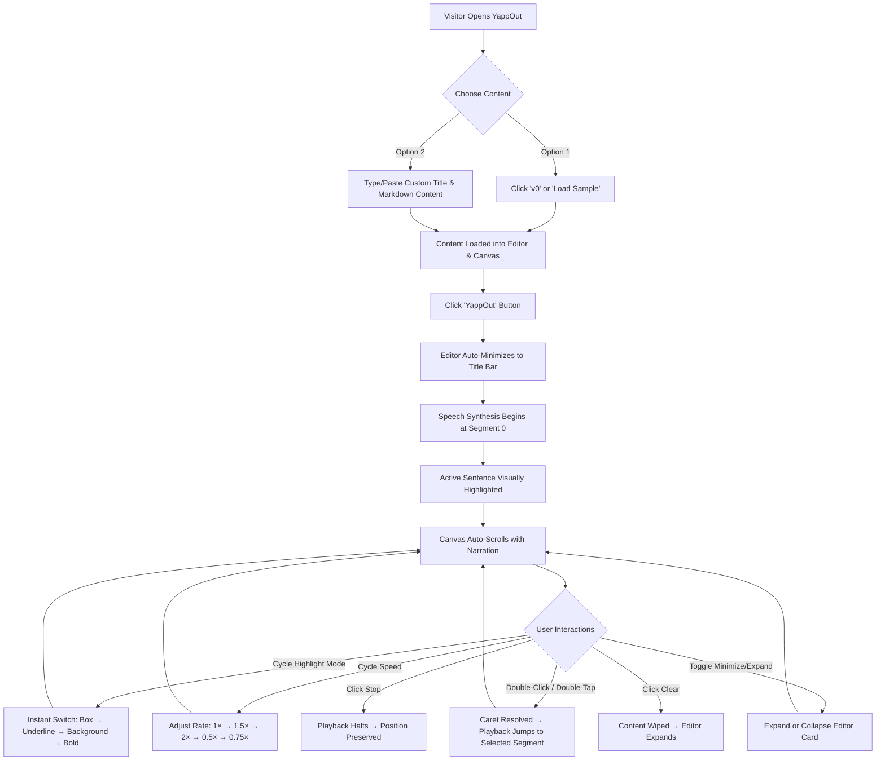
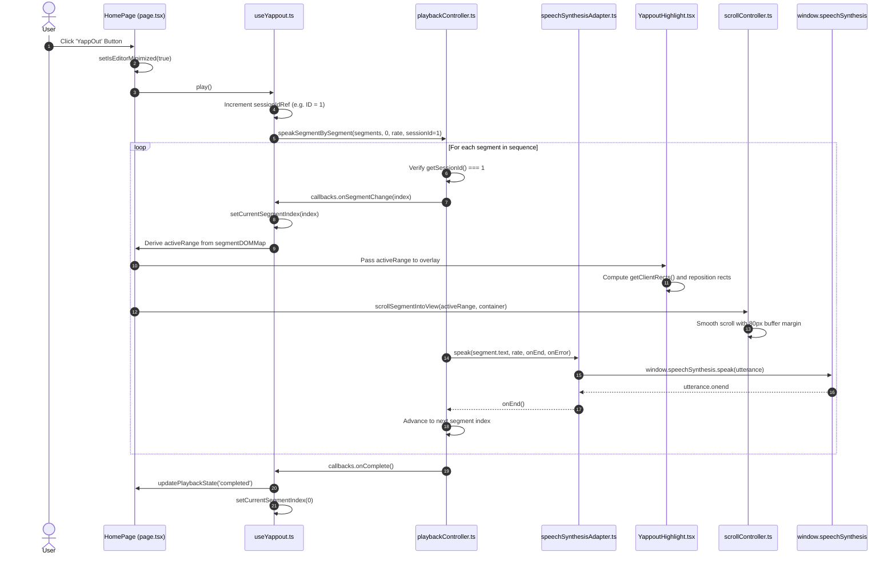
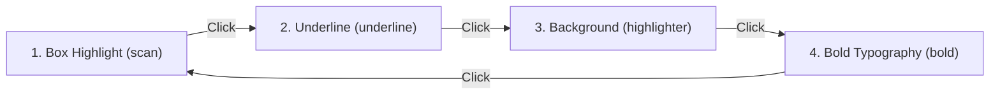

# YappOut V0 — Product and Technical Documentation

> **Document ID:** YVS-YAPPOUT-V0-TECH-001  
> **Product:** YappOut  
> **Version:** V0 (Standalone Client-Side Release)  
> **Organization:** Yet Vast Solutions (YVS)  
> **Repository:** `YetVastSolutions/yappout`  
> **Date:** November 16, 2026  
> **Authoritative Baseline:** Completed V0 Implementation and Audit  
> **Target Audience:** Developers, System Architects, Quality Engineers, AI Coding Agents  

---

## 1. Document Control and Version

| Attribute | Details |
|---|---|
| **Document Title** | YappOut V0 Product and Technical Architecture Specification |
| **Status** | Canonical Final Release Baseline |
| **Document Version** | 1.0.0 |
| **Framework Version** | Next.js 16.3.6 (App Router) / React 19.2.8 |
| **Language Target** | TypeScript 5.7.3 (Strict Mode) |
| **Deployment Target** | Vercel (Edge / CDN Static Prerendering) |
| **Previous Revisions** | `2026-11-16-yappout-v0-implementation.md`, `2026-11-16-yappout-v0-ui-refinement.md`, `2026-11-16-yappout-v0-ui-alignment.md` |

---

## 2. Executive Summary

**YappOut** is an independent, audio-first multimodal reading application developed under the Yet Vast Solutions (YVS) umbrella. It bridges the gap between text consumption and audio comprehension by converting user-supplied plain text and Markdown into natural spoken audio via the browser's native Web Speech API while simultaneously tracking narration through real-time visual highlight overlays.

The V0 product philosophy prioritizes **zero friction, zero cost, absolute privacy, and non-mutating DOM architecture**:
1. **Zero Registration & Backend Dependency:** Any visitor can open YappOut, input content of arbitrary length, click **YappOut**, and immediately begin reading and listening.
2. **Local Processing:** Content never leaves the client browser. No databases, third-party cloud speech services, cookies, or remote telemetries are utilized.
3. **Non-Mutating Overlay:** Visual highlighting is computed through standard DOM Range calculations projected onto a fixed-position overlay. The underlying document innerHTML is never modified or wrapped in span tags, ensuring zero layout instability and complete formatting preservation.
4. **Resilient Session Architecture:** A monotonic session-guard token pattern guarantees that asynchronous Web Speech callbacks cannot desynchronize state during rapid seeking, speed adjustments, or content replacement.

---

## 3. Product Overview

### 3.1 Purpose & Problem Statement
Traditional digital reading suffers from visual fatigue, attention fragmentation, and line-skipping, particularly during the review of dense technical papers, documentation, or long-form essays. Conversely, audio-only playback divorces speech from typography, eliminating visual anchoring and making skimming or spatial navigation difficult.

YappOut solves this by unifying **ear and eye into synchronized dual-modality consumption**. As speech progresses, visual highlighting tracks the active sentence in real time. Readers can listen passively, read visually, or use spatial caret gestures (double-click on desktop, double-tap on mobile) to jump playback to any sentence on the screen.

### 3.2 Intended Users
- **Developers & Engineers:** Reading technical documentation, RFCs, and architecture proposals.
- **Researchers & Students:** Consuming academic papers, literature reviews, and long-form reference articles.
- **Auditory & Multimodal Learners:** Users who retain information significantly better when visual reading is augmented by spoken narration.
- **Proofreaders & Writers:** Listening to their own prose to detect awkward sentence cadence and punctuation errors.

### 3.3 Core Value Proposition
- Immediate usability: no signup, no API keys, no configuration.
- Native speech synthesis without subscription fees or rate limits.
- Precise sentence-by-sentence pacing with four distinct presentation highlight styles.
- Bidirectional navigation: audio drives visual auto-scrolling; visual clicking drives audio seeking.

---

## 4. Product Goals and Scope

### 4.1 In-Scope for V0
- Single-page application loaded at `/`.
- Content input accepting plain text and Markdown.
- Punctuation-aware sentence and clause segmentation.
- Sequential client-side utterance queuing via native Web Speech API (`window.speechSynthesis`).
- Fixed visual overlay highlighting supporting four distinct selectable modes:
  1. Box highlight (outline + drop shadow)
  2. Underline (solid baseline stroke)
  3. Background (translucent highlighter wash)
  4. Bold (faux-bold typography styling via CSS Custom Highlights & SVG dilate)
- Spatial caret seeking via desktop double-click and mobile double-tap.
- Viewport auto-scrolling maintaining an 80px boundary margin.
- 5-step playback speed cycle (`1× -> 1.5× -> 2× -> 0.5× -> 0.75× -> 1×`).
- Collapsible content editor workspace during narration.
- Single source of truth sample content file (`public/yappout-info.json`) accessible via `v0` button.
- Canonical YVS design tokens (`#4B0084` Indigo-Violet, `#FFFF11` Yellow) with light/dark theme toggle.

### 4.2 Explicit V0 Exclusions
- User authentication and accounts (Yet Vast Auth, Firebase, OAuth).
- Server-side persistence or database storage (Firestore, PostgreSQL, Supabase).
- Cloud TTS integration (ElevenLabs, Google Cloud Text-to-Speech, Amazon Polly).
- Reading history, user bookmarks, or cloud document syncing.
- File uploads, PDF ingestion, EPUB parsing, or URL scraping.
- Browser extensions or native mobile wrappers.
- Analytics, tracking scripts, or advertising networks.

---

## 5. User Experience and Workflows

### 5.1 Primary User Workflows



1. **New Visitor Initial State:**
   - The application opens with empty title and body inputs.
   - The primary YappOut button, Speed button, and Highlight Mode button are disabled to prevent invalid operations.
   - The Reading Canvas presents a subtle empty state prompt: *"Nothing to read yet. Enter or paste text above, or click 'Load Sample' to test YappOut's audio-first synchronized reading engine."*
   - The title row provides a `Load Sample` button.

2. **Loading Sample Content:**
   - Visitor clicks the `v0` badge in the header or `Load Sample` in the title row.
   - Active playback (if any) halts immediately.
   - `/yappout-info.json` is fetched asynchronously.
   - The document title and Markdown body are populated.
   - The Player Controls enable immediately; word count, reading duration, and total segments are computed and displayed.

3. **Starting Playback & Workspace Minimization:**
   - Visitor clicks **YappOut**.
   - The content editor collapses, hiding the large textarea and Clear button.
   - The title row remains fixed at the top, displaying the document title and an `Expand` (`ChevronDown`) toggle.
   - Web Speech API begins narrating the document title first, followed by body segments in sequential order.
   - The active segment is visually highlighted in the Reading Canvas.
   - The canvas automatically scrolls to keep the narration comfortably in view.

4. **In-Flight Presentation & Speed Adjustments:**
   - Clicking the Highlight Mode button cycles the visual treatment (`Box -> Underline -> Background -> Bold -> Box`). The change updates the DOM overlay instantaneously without interrupting speech.
   - Clicking the Speed button advances the rate (`1× -> 1.5× -> 2× -> 0.5× -> 0.75×`). Playback continues from the current sentence at the newly selected rate without restarting from the top.

5. **Spatial Seeking (Double-Click / Double-Tap):**
   - The user spots a sentence of interest further down the canvas.
   - On desktop, double-clicking any word or sentence resolves the caret coordinates to the target segment.
   - On mobile, double-tapping (300ms window, 20px slop) performs the identical seek operation.
   - Speech synthesis halts the current utterance, increments the session ID, starts speaking from the clicked sentence, repositions the highlight overlay, and auto-scrolls the view.

6. **Stopping and Clearing:**
   - Clicking **Stop** halts audio playback. The current expanded/collapsed state of the editor is preserved to avoid layout displacement.
   - Clicking **Clear** stops audio, resets the title and body to empty strings, resets playback progress, and restores the editor to its expanded state.

---

## 6. Complete Feature Inventory

| Feature | Scope / Responsibility | Implementation File(s) | Verification Status | Evidence |
|---|---|---|---|---|
| **Header Branding** | Displays YappOut logo, title, and compact `v0` sample loader button | `src/components/layout/Header.tsx`, `Header.module.css` | **TESTED** | `tests/components.test.tsx` (renders title, v0, no subtitle) |
| **Theme Toggle** | Switches between light and dark modes, persists in `localStorage` | `src/components/layout/Header.tsx`, `src/styles/tokens.css` | **TESTED** | `tests/components.test.tsx` (theme toggle execution) |
| **Public Info & Sample** | Central single source of truth for product metadata and sample Markdown | `public/yappout-info.json` | **TESTED** | `tests/components.test.tsx` (JSON schema and field assertions) |
| **Collapsible Editor** | Accepts plain text/Markdown; auto-minimizes during playback | `src/components/input/ContentEditor.tsx`, `ContentEditor.module.css` | **TESTED** | `tests/components.test.tsx` (minimize/expand state assertions) |
| **Title-Side Actions** | Contextual controls on title row: `Load Sample`, `Clear`, `Minimize`, `Expand` | `src/components/input/ContentEditor.tsx` | **TESTED** | `tests/components.test.tsx` (button ordering and click handlers) |
| **Word Counter** | Real-time whitespace token count of combined title and body | `src/app/page.tsx`, `src/components/player/PlayerControls.tsx` | **TESTED** | `tests/components.test.tsx` (word count formatting) |
| **Duration Estimator** | Calculated reading time based on canonical 160 WPM speech rate | `src/app/page.tsx`, `src/components/player/PlayerControls.tsx` | **TESTED** | `tests/components.test.tsx` (duration format `< 1 min`, `X min`) |
| **Player Controls Toolbar** | Left info group (words, duration, segments) + Right controls (highlight, speed, play) | `src/components/player/PlayerControls.tsx`, `PlayerControls.module.css` | **TESTED** | `tests/components.test.tsx` (two-group button ordering and state) |
| **Highlight Mode Selector** | Cycles through Box, Underline, Background, and Bold modes | `src/components/player/HighlightModeSelector.tsx` | **TESTED** | `tests/components.test.tsx` (exact cycle sequence) |
| **Speed Controller** | Cycles through `1×`, `1.5×`, `2×`, `0.5×`, `0.75×` without playback restart | `src/core/speedController.ts`, `src/components/player/YappOutSpeed.tsx` | **TESTED** | `tests/speedController.test.ts` (cycle indices and rate values) |
| **Primary Action Button** | Toggles playback state between idle, playing, and stopped | `src/components/player/YappOutButton.tsx` | **TESTED** | `tests/components.test.tsx` (play/stop state, disabled when empty) |
| **Punctuation Segmentation** | Delimiter-based splitting with abbreviation and number preservation | `src/utils/textNormalizer.ts` | **TESTED** | `tests/readingSequence.test.ts` (delimiter, abbreviation, decimals) |
| **Markdown Extraction** | Strips Markdown syntax for clean speech and tokenization | `src/utils/markdownExtractor.ts` | **TESTED** | `tests/readingSequence.test.ts` (fenced code, links, formatting) |
| **Reading Canvas** | Renders sanitized HTML from Markdown via Marked and DOMPurify | `src/components/reader/ReadingCanvas.tsx`, `ReadingCanvas.module.css` | **TESTED** | `tests/components.test.tsx` (DOM render without header text) |
| **Non-Mutating Overlay** | Fixed-position visual highlight overlay utilizing DOM Range APIs | `src/components/reader/YappoutHighlight.tsx` | **TESTED** | `tests/components.test.tsx` (box, underline, background, bold styles) |
| **CSS Custom Highlights** | Synchronizes `::highlight(yappout-bold)` for non-mutating bold mode | `src/components/reader/YappoutHighlight.tsx` | **TESTED** | `tests/components.test.tsx` (bold styling verification) |
| **Spatial Caret Seeking** | Resolves double-click/double-tap coordinates to reading segments | `src/hooks/useYappout.ts`, `src/core/wordTracker.ts` | **TESTED** | `tests/wordTracker.test.ts`, `tests/doubleTapDetector.test.ts` |
| **Double-Tap Detection** | Gesture recognizer with 300ms window and 20px slop tolerance | `src/utils/doubleTapDetector.ts` | **TESTED** | `tests/doubleTapDetector.test.ts` (timing and movement tolerance) |
| **Auto-Scrolling** | Smooth scroll positioning with 80px boundary margin buffer | `src/core/scrollController.ts` | **TESTED** | `tests/scrollController.test.ts` (top/bottom margin calculations) |
| **Speech Adapter** | Native Web Speech API abstraction with mock test adapter | `src/adapters/speechSynthesisAdapter.ts` | **TESTED** | `tests/playbackController.test.ts`, `tests/appFlow.test.ts` |
| **Session Protection** | Monotonic session IDs preventing stale asynchronous callbacks | `src/core/playbackController.ts`, `src/hooks/useYappout.ts` | **TESTED** | `tests/playbackController.test.ts` (session guard cancellation) |

---

## 7. Technology Stack

### 7.1 Direct Production Dependencies
- **Next.js (`16.3.6`):** App Router, Server Components, Turbopack production compiler.
- **React (`19.2.8`):** UI component model, `useTransition`, `useMemo`, `useCallback`, `useRef`.
- **React DOM (`19.2.8`):** Client-side DOM hydration and rendering.
- **Lucide React (`^1.48.0`):** Iconography (`Volume2`, `Square`, `Scan`, `Underline`, `Highlighter`, `Bold`, `ChevronDown`, `ChevronUp`, `FileText`, `Trash2`, `Type`, `Clock`, `MousePointerClick`, `Moon`, `Sun`, `BookOpen`).
- **Marked (`^15.0.7`):** Synchronous Markdown parsing engine.
- **DOMPurify (`isomorphic-dompurify` `^4.5.0`):** HTML sanitization against XSS vectors.

### 7.2 Development & Tooling Dependencies
- **TypeScript (`^5.7.3`):** Strict static type checking (`strict: true`, `noEmit: true`).
- **Vitest (`^3.0.5`):** Unit and component testing engine with native ESM support.
- **JSDOM (`^26.0.0`):** Browser DOM simulation environment for headless automated testing.
- **ESLint (`^9.19.0`):** Flat configuration static analysis (`eslint-config-next` 16.3.6).
- **Node.js Target:** Node.js v20+ / v22+ / v26.

### 7.3 Styling & Asset Pipeline
- **CSS Modules:** Scoped component styling (`*.module.css`).
- **CSS Custom Properties:** Shared design tokens in `src/styles/tokens.css`.
- **Zero Tailwind CSS / Zero CSS-in-JS:** No utility-class engines or runtime stylesheet injection.

---

## 8. Repository Structure

```text
yappout/
├── docs/
│   ├── implementation/
│   │   ├── 2026-11-16-yappout-v0-implementation.md   # Initial V0 standalone implementation report
│   │   ├── 2026-11-16-yappout-v0-ui-refinement.md     # UI refinement & highlight modes report
│   │   ├── 2026-11-16-yappout-v0-ui-alignment.md      # UI alignment & control grouping report
│   │   └── 2026-11-16-yappout-v0-final-audit.md       # Final comprehensive codebase audit record
│   ├── YVS_Application_Development_Standards_v1.0.0.md # Central YVS engineering standards
│   └── YAPPOUT_V0_PRODUCT_AND_TECHNICAL_DOCUMENTATION.md # THIS CANONICAL DOCUMENT
├── public/
│   └── yappout-info.json                              # Single source of truth product & sample data
├── src/
│   ├── adapters/
│   │   └── speechSynthesisAdapter.ts                  # Web Speech API wrapper & mock test adapter
│   ├── app/
│   │   ├── globals.css                                # Global resets, typography foundations & tokens
│   │   ├── layout.tsx                                 # HTML shell and metadata
│   │   ├── page.module.css                            # Homepage container styles
│   │   └── page.tsx                                   # Main YappOut standalone application page
│   ├── components/
│   │   ├── input/
│   │   │   ├── ContentEditor.module.css               # Collapsible editor styles
│   │   │   └── ContentEditor.tsx                      # Collapsible text editor with title actions
│   │   ├── layout/
│   │   │   ├── Header.module.css                      # Sticky header styles & v0 badge
│   │   │   └── Header.tsx                             # Brand identity, v0 loader & theme toggle
│   │   ├── player/
│   │   │   ├── HighlightModeSelector.tsx              # Presentation highlight mode cycler
│   │   │   ├── PlayerControls.module.css              # Player toolbar styles (left info, right controls)
│   │   │   ├── PlayerControls.tsx                     # Two-group playback controls toolbar
│   │   │   ├── YappOutButton.tsx                      # Play/Stop primary action button
│   │   │   └── YappOutSpeed.tsx                       # Speed cycler button
│   │   └── reader/
│   │       ├── ReadingCanvas.module.css               # Canvas typography & container styles
│   │       ├── ReadingCanvas.tsx                      # Rendered Markdown reader
│   │       └── YappoutHighlight.tsx                   # Fixed non-mutating multi-mode highlight overlay
│   ├── constants/
│   │   └── index.ts                                   # Brand colors, highlight modes & speed values
│   ├── core/
│   │   ├── playbackController.ts                      # Segment-by-segment session-guarded controller
│   │   ├── readingSequence.ts                         # Sequence builder combining title and body tokens
│   │   ├── scrollController.ts                        # Auto-scroll controller with 80px buffer
│   │   ├── seekController.ts                          # Seek request type definitions
│   │   ├── speedController.ts                         # Speed cycling indices, values, and labels
│   │   └── wordTracker.ts                             # DOM TreeWalker range mapper & caret resolver
│   ├── hooks/
│   │   └── useYappout.ts                              # Primary React hook orchestrating playback & DOM
│   ├── styles/
│   │   └── tokens.css                                 # Semantic design tokens & light/dark palettes
│   ├── types/
│   │   └── index.ts                                   # Central domain TypeScript interfaces
│   ├── utils/
│   │   ├── doubleTapDetector.ts                       # Touch & mouse gesture detector
│   │   ├── markdownExtractor.ts                       # Markdown stripping & paragraph extractor
│   │   └── textNormalizer.ts                          # Punctuation boundary segmenter & normalizer
│   └── index.ts                                       # Barrel exports for standalone engine
├── tests/
│   ├── appFlow.test.ts                                # Core application state integration tests
│   ├── components.test.tsx                            # Comprehensive React component test suite
│   ├── doubleTapDetector.test.ts                      # Touch/mouse gesture timing and tolerance tests
│   ├── playbackController.test.ts                     # Segment playback and session guard tests
│   ├── readingSequence.test.ts                        # Segmentation, abbreviation & number parsing tests
│   ├── scrollController.test.ts                       # 80px boundary margin auto-scroll tests
│   ├── speedController.test.ts                        # Speed cycle progression and label tests
│   └── wordTracker.test.ts                            # DOM Range mapping and caret resolution tests
├── eslint.config.mjs                                  # ESLint 9 flat configuration
├── next.config.ts                                     # Next.js configuration (reactStrictMode: true)
├── package.json                                       # Dependencies and build scripts
├── tsconfig.json                                      # Strict TypeScript configuration
└── vitest.config.ts                                   # Vitest testing configuration with JSDOM
```

---

## 9. Architecture Overview

### 9.1 High-Level Architecture Diagram

```mermaid
graph TD
    subgraph UI_Layer [Presentation Layer (React Components)]
        Header[Header.tsx]
        Editor[ContentEditor.tsx]
        Controls[PlayerControls.tsx]
        HighlightSelector[HighlightModeSelector.tsx]
        SpeedButton[YappOutSpeed.tsx]
        PlayButton[YappOutButton.tsx]
        Canvas[ReadingCanvas.tsx]
        Overlay[YappoutHighlight.tsx]
    end

    subgraph State_Layer [State & Orchestration]
        Page[page.tsx (State Orchestrator)]
        Hook[useYappout.ts]
    end

    subgraph Core_Engine [Core Reading Engine]
        SequenceBuilder[readingSequence.ts]
        PlaybackCtrl[playbackController.ts]
        SpeedCtrl[speedController.ts]
        ScrollCtrl[scrollController.ts]
        WordTracker[wordTracker.ts]
    end

    subgraph Adapters_Utils [Adapters & Utilities]
        SpeechAdapter[speechSynthesisAdapter.ts]
        Normalizer[textNormalizer.ts]
        MDExtractor[markdownExtractor.ts]
        DoubleTap[doubleTapDetector.ts]
    end

    subgraph Browser_APIs [Browser APIs]
        WebSpeech[window.speechSynthesis]
        DOMRange[DOM Range & getClientRects]
        CSSHighlight[CSS.highlights API]
    end

    Page --> Hook
    Page --> Header
    Page --> Editor
    Page --> Controls
    Page --> Canvas

    Controls --> HighlightSelector
    Controls --> SpeedButton
    Controls --> PlayButton

    Canvas --> Overlay

    Hook --> PlaybackCtrl
    Hook --> SequenceBuilder
    Hook --> WordTracker
    Hook --> ScrollCtrl
    Hook --> SpeedCtrl
    Hook --> DoubleTap

    PlaybackCtrl --> SpeechAdapter
    SpeechAdapter --> WebSpeech

    SequenceBuilder --> Normalizer
    SequenceBuilder --> MDExtractor

    WordTracker --> DOMRange
    Overlay --> DOMRange
    Overlay --> CSSHighlight
    ScrollCtrl --> Canvas
```

---

## 10. Application Initialization

1. **Root HTML Shell (`src/app/layout.tsx`):**
   - Configures HTML metadata (`title: 'YappOut — Audio-First Synchronized Reader'`, description, viewport settings).
   - Injects global stylesheet `src/app/globals.css`.
   - Mounts the root React 19 tree.

2. **Global Styling & Tokens (`src/app/globals.css`, `src/styles/tokens.css`):**
   - CSS resets box sizing, margins, and typography smoothing.
   - Declares canonical YVS design tokens in `:root` and `[data-theme='dark']`.
   - Theme toggle sets `data-theme` attribute on `document.documentElement`.

3. **Homepage Initialization (`src/app/page.tsx`):**
   - Initializes local React states: `title = ''`, `content = ''`, `isEditorMinimized = false`, `highlightMode = 'box'`.
   - Creates DOM refs: `titleRef`, `bodyRef`, and `scrollContainerRef`.
   - Invokes `useYappout` hook with title, content, and container refs.

---

## 11. Component Architecture

### 11.1 Header Component (`src/components/layout/Header.tsx`)
- **Brand Identity:** Renders the 32×32px YappOut logo badge (`#4B0084` background, `#FFFF11` Volume2 icon).
- **`v0` Sample Loader Badge:** Compact button (`v0`) immediately right of the product name. Vertically aligned to the font baseline (`position: relative; top: 2px`). Clicking triggers `onLoadSample`.
- **Theme Switch:** Toggles between `light` and `dark` mode. Persists selection in `localStorage` under key `yappout_theme`.

### 11.2 Content Editor (`src/components/input/ContentEditor.tsx`)
- **Title Row:** Flexible-width input for optional document title.
- **Contextual Action Group:**
  - When expanded with content: renders `Clear` button immediately followed by `Minimize` button.
  - When expanded and empty: renders `Load Sample` button.
  - When minimized: hides `Clear`, renders `Expand` button.
- **Body Textarea:** Large multiline input (min-height 220px, max-height 500px) accepting Markdown or plain text. Unmounted or hidden when minimized.

### 11.3 Player Controls (`src/components/player/PlayerControls.tsx`)
- **Container:** Sticky bar (`position: sticky; top: calc(var(--header-height) + 0.5rem)`).
- **Left Information Group:**
  1. Word count (`Type` icon + formatted number).
  2. Reading duration (`Clock` icon + calculated time).
  3. Segment count badge (`Segment X / Y` during playback, or `Y segments` when idle) and animated progress bar.
  4. Subtle inline gesture instruction: `Double-click or double-tap any sentence to seek`.
- **Right Controls Group:**
  1. `HighlightModeSelector`: Compact icon button cycling highlight modes.
  2. `YappOutSpeed`: Compact button cycling playback speed.
  3. `YappOutButton`: High-visibility primary action button (Purple in idle, Red in playing).

### 11.4 Reading Canvas (`src/components/reader/ReadingCanvas.tsx`)
- **Sanitized Markdown Rendering:** Processes content using `marked.parse(content, { async: false })` and sanitizes raw HTML using `DOMPurify.sanitize(rawHtml)`.
- **Primary Typography:** 1.08rem body font size with 1.8 line height.
- **Scroll Container:** Houses title heading (`titleRef`) and rendered body (`bodyRef`).
- **Overlay Injection:** Mounts `YappoutHighlight` within the scroll container.

### 11.5 Visual Highlight Overlay (`src/components/reader/YappoutHighlight.tsx`)
- Renders zero-mutation floating overlay rects computed from `activeRange.getClientRects()`.
- Synchronizes `::highlight(yappout-bold)` for bold typographic rendering.

---

## 12. State Management

| State Variable | Owner | Type | Purpose |
|---|---|---|---|
| `title` | `HomePage` | `string` | User-entered document title |
| `content` | `HomePage` | `string` | User-entered body text / Markdown |
| `isEditorMinimized` | `HomePage` | `boolean` | Controls whether editor textarea is collapsed |
| `highlightMode` | `HomePage` | `HighlightMode` | Active highlight visual style (`box`, `underline`, `background`, `bold`) |
| `playbackState` | `useYappout` | `PlaybackState` | Current playback state (`idle`, `playing`, `stopped`, `completed`) |
| `currentSegmentIndex` | `useYappout` | `number` | Index of the currently spoken segment |
| `speedCycleIdx` | `useYappout` | `number` | Index into `SPEED_CYCLE` (0 = 1×, 1 = 1.5×, 2 = 2×, 3 = 0.5×, 4 = 0.75×) |
| `segmentDOMMap` | `useYappout` | `SegmentDOMMap` | Array mapping segment indices to live DOM `Range` objects |
| `wordDOMMap` | `useYappout` | `WordDOMMap` | Array mapping word indices to live DOM `Range` objects |
| `sessionIdRef` | `useYappout` | `useRef<number>` | Monotonic token guarding against stale asynchronous callbacks |
| `activeRange` | `useYappout` | `Range \| null` | Derived active DOM Range for the current segment |

---

## 13. Text Processing and Markdown Handling

### 13.1 Markdown Stripping (`src/utils/markdownExtractor.ts`)
Before text is queued for speech synthesis or tokenization, raw Markdown formatting must be stripped so TTS does not vocalize syntax symbols (such as `#`, `*`, `_`, or `~~`).
- Fenced code blocks (` ```...``` `) and inline code (`` `...` ``) are excised.
- Images (``) and links (`[text](url)`) are converted to their human-readable alt/anchor text.
- Heading markers (`#`), bold/italic delimiters (`*`, `_`), blockquote markers (`>`), and horizontal rules (`---`) are stripped cleanly.
- Implemented with regex matching using `[\s\S]*?` for ES2017+ cross-platform compatibility.

### 13.2 HTML Sanitization (`src/components/reader/ReadingCanvas.tsx`)
For visual display, raw Markdown is compiled to HTML via `marked` and sanitized synchronously through `DOMPurify`.
This protects against script injection, cross-site scripting (XSS), and malicious iframe embedding while preserving semantic elements (`<h1>`–`<h4>`, `<p>`, `<ul>`, `<ol>`, `<li>`, `<blockquote>`, `<code>`).

---

## 14. Reading Sequence and Segmentation

The reading sequence generator (`src/core/readingSequence.ts`) produces an ordered array of segments and word tokens.

### 14.1 Boundary Detection Rules (`src/utils/textNormalizer.ts`)
A segment boundary is triggered by:
1. **Delimiters:** Standard punctuation marks: `. , ? ! : ; … — –` and CJK marks `。 ， 、 ！ ？ ： ；`.
2. **Line Breaks:** Carriage returns (`\r`) and newlines (`\n`).

### 14.2 Boundary Protection Exceptions
Punctuation marks do **not** trigger a segment break when:
1. **Numbers & Decimals:** The delimiter is between two digits (e.g. `3.14`, `10,000`, `10:30`).
2. **Common English Abbreviations:** Full stops belonging to common honorifics and abbreviations: `Mr.`, `Mrs.`, `Ms.`, `Dr.`, `Prof.`, `Sr.`, `Jr.`, `vs.`, `etc.`, `dept.`, `est.`, `approx.`, `St.`, `e.g.`, `i.e.`.
3. **Closing Punctuation Attachment:** Trailing quotes and brackets (`"`, `'`, `”`, `’`, `»`, `)`, `]`, `}`) remain attached to the preceding segment.

### 14.3 Title-First Sequencing
If a document title is provided:
- Title segments are indexed first (`section: 'title'`, index `0` to `titleSegmentCount - 1`).
- Body segments follow sequentially (`section: 'body'`, index `titleSegmentCount` to `N - 1`).

---

## 15. Speech Synthesis Architecture

### 15.1 Speech Adapter Abstraction (`src/adapters/speechSynthesisAdapter.ts`)
Direct calls to browser globals are encapsulated behind the `SpeechAdapter` interface:
```typescript
export interface SpeechAdapter {
  speak(
    text: string,
    rate: number,
    onEnd: () => void,
    onError: (error?: string) => void,
  ): void;
  cancel(): void;
  isSupported(): boolean;
}
```

### 15.2 Native Implementation Details
- Instantiates `SpeechSynthesisUtterance(text)` per segment.
- Configures `utterance.rate = rate` and `utterance.lang = 'en-US'`.
- Handles `utterance.onend` by invoking `onEnd()`.
- Handles `utterance.onerror`: Filters out benign `'canceled'` and `'interrupted'` events caused by seeking or stopping, forwarding only true speech synthesis failures.
- Calls `window.speechSynthesis.speak(utterance)`.

---

## 16. Playback Lifecycle

### 16.1 Sequence Diagram



---

## 17. Highlighting Architecture

### 17.1 Non-Mutating Guarantee
Many conventional reader applications modify the DOM by wrapping words in `<span>` or `<mark>` tags, which causes layout shifts, breaks React virtual DOM diffing, and corrupts Markdown structure.

YappOut guarantees **zero DOM mutation**:
1. When content is rendered into `ReadingCanvas`, a DOM `TreeWalker` traverses all text nodes (`src/core/wordTracker.ts`).
2. Exact character offsets are mapped to construct browser DOM `Range` objects for every segment (`SegmentDOMMap`).
3. During playback, the active segment's `Range` is passed to `YappoutHighlight`.
4. `Range.getClientRects()` returns bounding rectangles for each individual line fragment when text wraps across multiple lines.
5. Fixed-position (`position: fixed; pointer-events: none; z-index: 9000`) overlay `div` elements are positioned directly above the text.
6. Container scroll and window resize events recalculate rectangle positions passively.

---

## 18. Four Highlight Modes

The application supports four selectable highlight presentation modes:



### 18.1 Mode Specifications

| Mode | Key | Lucide Icon | Visual Treatment | CSS / Technical Implementation |
|---|---|---|---|---|
| **Box Highlight** | `box` | `Scan` | Yellow outline with Indigo-Violet outer drop shadow around active sentence lines | `outline: 2px solid var(--highlight-inner); boxShadow: 0 0 0 4px var(--highlight-outer); borderRadius: 2px; background: transparent;` |
| **Underline** | `underline` | `Underline` | Solid 3.5px line bar beneath the active sentence | `borderBottom: 3.5px solid var(--highlight-underline); background: transparent; borderRadius: 0;` (anchored to line rect bottom) |
| **Background** | `background` | `Highlighter` | Translucent color wash covering the active sentence | `background: var(--highlight-bg); borderRadius: 3px;` (45% alpha yellow in light, 28% in dark) |
| **Bold** | `bold` | `Bold` | Emboldened typography without box or background fills | Non-mutating CSS Custom Highlight API `::highlight(yappout-bold)` text-shadow with SVG dilate filter fallback |

All four modes:
- Use the identical active Range and segment tracking mechanism.
- Work flawlessly on multiline sentences, headings, blockquotes, and lists.
- Update immediately when toggled during active playback without restarting speech.

---

## 19. Seeking Architecture

Users can instantly navigate playback by interacting directly with the text:
1. **Desktop Seeking:** Double-clicking (`dblclick`) on any word or sentence.
2. **Mobile Seeking:** Double-tapping (`touchend`) on touchscreen devices.

### 19.1 Gesture Detection (`src/utils/doubleTapDetector.ts`)
- Tracks `lastTapTime`, `lastTapX`, and `lastTapY`.
- Detection window: `YAPPOUT_DOUBLE_TAP_DELAY = 300ms`.
- Movement tolerance slop: `YAPPOUT_TAP_SLOP = 20px`.
- Single taps, dragging, and normal page scrolling are ignored.

### 19.2 Coordinate Resolution to DOM Segment
- Coordinates `(clientX, clientY)` are passed to `getCaretRangeFromPoint(x, y)`.
- Uses `document.caretRangeFromPoint(x, y)` (Chromium/WebKit) or `document.caretPositionFromPoint(x, y)` (Firefox).
- The caret Range is compared against `segmentDOMMap` using `range.comparePoint(caretNode, caretOffset)`.
- Playback stops, `sessionIdRef` increments, and speech resumes immediately from the target segment.

---

## 20. Auto-Scrolling

The auto-scroll controller (`src/core/scrollController.ts`) ensures the active segment remains visible:
- Buffer zone: `YAPPOUT_SCROLL_MARGIN = 80px`.
- Compares segment bounding top/bottom with container scroll boundaries:
  - If `segmentTop - margin < scrollTop`: smooth scrolls up to `Math.max(0, segmentTop - margin)`.
  - If `segmentBottom + margin > scrollTop + clientHeight`: smooth scrolls down to `segmentBottom + margin - clientHeight`.
- Prevents jumpy scrolling; only scrolls when the active segment approaches the viewport edge.

---

## 21. Playback Speed

The speed controller (`src/core/speedController.ts`) manages speech rates:
- Speed cycle array: `[1, 1.5, 2, 0.5, 0.75]`.
- Human labels: `['1×', '1.5×', '2×', '0.5×', '0.75×']`.
- Default: `1×` (index 0).
- In-flight adjustment: When clicked while playing, `speedRef.current` updates, a new session ID is generated, and `speakSegmentBySegment` continues from the current segment index at the new rate without resetting to the start.

---

## 22. Session Management and Race Protection

Asynchronous speech synthesis events are prone to race conditions (e.g. rapid clicking of play, stop, seek, speed toggle, or clearing content).

YappOut solves this through a **monotonic session guard**:
1. `sessionIdRef` starts at `0`.
2. Any action invalidating active speech increments `sessionIdRef.current++` and invokes `adapter.cancel()`.
3. When `speakSegmentBySegment` runs, it captures the current `sessionId`.
4. In every callback (`onEnd`, `onError`, `speakNext`), the controller executes:
   ```typescript
   if (getSessionId() !== sessionId) return; // Stale session guard
   ```
5. Any callback originating from an outdated session terminates immediately, guaranteeing zero zombie speech or desynchronized highlighting.

---

## 23. Theme and Design System

### 23.1 Canonical YVS Colors
- **YVS Indigo-Violet:** `#4B0084` (Hover: `#5e02a5`, Active: `#3b0068`)
- **YVS Yellow:** `#FFFF11` (Dark hover: `#ffea33`)

### 23.2 Semantic Token Structure (`src/styles/tokens.css`)

| Token | Light Theme | Dark Theme |
|---|---|---|
| `--bg-primary` | `#FFFFFF` | `#09060D` |
| `--bg-secondary` | `#FAF8FC` | `#120D1A` |
| `--bg-tertiary` | `#F1EDF6` | `#1C1527` |
| `--bg-surface` | `#FFFFFF` | `#120D1A` |
| `--text-primary` | `#17121C` | `#F8F5FA` |
| `--text-secondary` | `#524A5C` | `#B7ADBF` |
| `--text-muted` | `#7E748A` | `#7A7085` |
| `--border-subtle` | `#E3DEE9` | `#291F36` |
| `--border-strong` | `#CDC5D6` | `#3F3250` |
| `--border-focus` | `#4B0084` | `#FFFF11` |
| `--action-primary-bg` | `#4B0084` | `#FFFF11` |
| `--action-primary-text` | `#FFFFFF` | `#09060D` |
| `--highlight-inner` | `#FFFF11` | `#FFFF11` |
| `--highlight-outer` | `#4B0084` | `#4B0084` |
| `--highlight-underline` | `#4B0084` | `#FFFF11` |
| `--highlight-bg` | `rgba(255, 255, 17, 0.45)` | `rgba(255, 255, 17, 0.28)` |

---

## 24. Responsive UI

- **Desktop Layout:** Centered reading width constrained by `--max-width-content: 860px`. Toolbar presents Left Information Group and Right Controls Group spaced across the full bar.
- **Mobile Layout (`@media (max-width: 768px)`):**
  - Content padding compresses to 0.75rem.
  - Controls bar stacks vertically: Left info group displays word count, duration, and segments; Right controls group preserves order (`[Highlight] [Speed] [YappOut]`) with `flex: 1` on YappOut button.
  - Zero horizontal overflow.

---

## 25. Accessibility

- **Semantic HTML:** `<header>`, `<main>`, `<section>`, `<textarea>`, `<button>`, `<input>`.
- **Keyboard Navigation:** All interactive controls (buttons, inputs) are native focusable elements with visible focus rings (`--border-focus`).
- **Screen Reader Labels:** Every icon-only button provides explicit `aria-label` and `title` attributes (e.g. `aria-label="Highlight mode: Underline. Click to cycle modes."`).
- **Progress Tracking:** Active reading progress uses `role="progressbar"` with `aria-valuenow`, `aria-valuemin`, and `aria-valuemax`.
- **Touch Target Sizes:** All interactive buttons maintain a minimum tap target height of 44px.

---

## 26. Data Flow and Privacy

- **100% Client-Side:** Text entered into YappOut is stored exclusively in ephemeral React component memory (`useState`).
- **Zero Remote Transmission:** Content is never sent to any server, endpoint, or external API.
- **No Cookies or Tracking:** No user cookies, local database records, or analytics tokens exist.
- **Local Theme Only:** The sole use of browser storage is a single string key (`yappout_theme`: `'light' | 'dark'`) in `localStorage`.

---

## 27. Error Handling and Reliability

1. **Unsupported Web Speech API:** In headless browsers or unsupported environments, `adapter.isSupported()` returns `false`; speech gracefully falls through without throwing exceptions.
2. **Markdown Parsing Failures:** If `marked.parse` encounters malformed syntax, a fallback catches the error and safely escapes angle brackets (`&lt;`, `&gt;`).
3. **Empty Utterances:** Whitespace-only segments are detected and skipped automatically in `speakSegmentBySegment`.
4. **Sample Loading Network Errors:** If `/yappout-info.json` cannot be retrieved, `handleLoadSample` catches the error, logs a console message, and preserves current state without crashing.
5. **Component Unmount Cleanup:** `useYappout` hook registers a cleanup effect that cancels active speech synthesis and increments `sessionIdRef` on component destruction.

---

## 28. Testing Architecture and Results

### 28.1 Automated Test Suites

| Test Suite File | Coverage Domain | Tests | Duration | Result |
|---|---|---|---|---|
| `tests/playbackController.test.ts` | Sequential segment playback, utterance ordering, completion & error callbacks | 4 | 19ms | **PASS** |
| `tests/speedController.test.ts` | Speed progression values (`1×` to `0.75×`), indexing, and labels | 2 | 15ms | **PASS** |
| `tests/scrollController.test.ts` | 80px margin buffer calculations for upward and downward scrolling | 2 | 21ms | **PASS** |
| `tests/doubleTapDetector.test.ts` | Touch gesture timing (300ms) and spatial slop tolerance (20px) | 3 | 35ms | **PASS** |
| `tests/readingSequence.test.ts` | Punctuation boundary segmentation, abbreviations, numbers, Markdown stripping | 7 | 29ms | **PASS** |
| `tests/appFlow.test.ts` | Application state integration, empty inputs, speech cancellation | 3 | 21ms | **PASS** |
| `tests/wordTracker.test.ts` | DOM TreeWalker range creation, cursor tracking, repeated word matching | 3 | 161ms | **PASS** |
| `tests/components.test.tsx` | Header v0, ContentEditor minimization/Clear, PlayerControls groups, Highlight modes, yappout-info.json schema | 14 | 211ms | **PASS** |
| **Total** | **Full application automated verification** | **38** | **513ms** | **ALL PASS** |

### 28.2 Verification Commands
- `npm run typecheck`: Passed (TypeScript `tsc --noEmit`, exit code 0).
- `npm run lint`: Passed (ESLint flat config, exit code 0).
- `npm test`: Passed (Vitest, 38/38 tests passing, exit code 0).
- `npm run build`: Passed (Next.js 16.3.6 static production build, exit code 0).

---

## 29. YVS Engineering Standards Compliance

| Standard Area | YVS Guideline Requirement | YappOut V0 Implementation | Status | Evidence |
|---|---|---|---|---|
| **Product Independence** | Products own their own product information | `public/yappout-info.json` serves as the local source of truth | **COMPLIANT** | JSON spec inspected |
| **TypeScript Strictness** | Strict type checking enabled, no implicit any | `tsconfig.json` has `strict: true`, `noEmit: true` | **COMPLIANT** | `npm run typecheck` passes |
| **Styling Architecture** | Pure CSS Modules and CSS custom properties; no Tailwind | CSS Modules used across all components; zero Tailwind | **COMPLIANT** | `src/**/*.module.css` |
| **Design Tokens** | Canonical YVS Indigo-Violet and Yellow palettes | Token definitions in `src/styles/tokens.css` | **COMPLIANT** | Tokens stylesheet inspected |
| **Non-Mutating DOM** | Never inject spans/wrappers into rendered reading DOM | DOM Range overlay architecture (`getClientRects`) | **COMPLIANT** | `YappoutHighlight.tsx` inspected |
| **Privacy & Zero Cost** | No paid cloud infrastructure or unnecessary backends | 100% browser-local speech synthesis and execution | **COMPLIANT** | Zero backend dependencies |
| **Automated Testing** | Unit and component verification with pass proof | Vitest with jsdom; 38 passing automated tests | **COMPLIANT** | Test execution logs verified |

---

## 30. Security and Code Quality Findings

- **XSS Prevention:** Markdown output rendered in `ReadingCanvas` is passed through `isomorphic-dompurify`.
- **No Secret Exposure:** Zero environment variables, API keys, or private tokens exist in the repository.
- **Race Condition Immunity:** Monotonic session guard eliminates asynchronous TTS callback conflicts.
- **Code Cleanliness:** All components use explicit TypeScript prop contracts. Barrel exports centralized in `src/index.ts`.

---

## 31. Deployment and Vercel Configuration

- **Framework:** Next.js App Router (Turbopack).
- **Output:** Static site generation (SSG) for `/` and `/_not-found`.
- **Hosting Target:** Vercel Edge/Serverless CDN.
- **Zero Environment Variables:** Requires no environment variables or configuration secrets.
- **Deployment Command:** `next build` (Vercel automatic detection).

---

## 32. Environment Variables and Dependencies

| Dependency | Category | Purpose |
|---|---|---|
| `next` | Production | React framework and App Router engine |
| `react` / `react-dom` | Production | UI runtime and component tree |
| `lucide-react` | Production | Lightweight SVG icons |
| `marked` | Production | Synchronous Markdown parser |
| `isomorphic-dompurify` | Production | HTML XSS sanitization |
| `vitest` / `jsdom` | Development | Automated testing framework and DOM simulation |
| `typescript` | Development | Static type analysis |
| `eslint` | Development | Code quality linter |

*No environment variables are required.*

---

## 33. V0 Feature Boundaries

### 33.1 Fully Implemented in V0
- Instant plain text & Markdown playback.
- Title-first narration order.
- Punctuation, abbreviation, and number-aware segmentation.
- Non-mutating Range-based highlight overlay.
- Four selectable highlight modes: Box, Underline, Background, and Bold.
- Desktop double-click and mobile double-tap spatial seeking.
- Continuous auto-scrolling with 80px margin buffer.
- 5-step speed cycle (`1×`, `1.5×`, `2×`, `0.5×`, `0.75×`).
- Collapsible editor workspace during playback.
- Single source of truth product info and sample content (`yappout-info.json`).
- Two-group player toolbar layout (Left info, Right controls).
- Light and dark theme support.

### 33.2 Deliberately Excluded from V0
- User authentication and cloud accounts.
- Cloud TTS (ElevenLabs, Google Cloud, AWS Polly).
- Reading history, document persistence, and cloud sync.
- PDF, EPUB, and URL article scraping.
- Voice pitch and timbre selection menus.

---

## 34. Known Limitations

1. **Voice Quality & Engine Availability:** Speech synthesis quality and available voices are governed entirely by the client's host operating system and browser.
2. **Mobile Background Tab Audio:** iOS Safari and Android Chrome may suspend `window.speechSynthesis` when the browser tab is backgrounded.
3. **Speech Word-Boundary Events:** While segmentation is sentence-based, individual word-boundary timing events in the Web Speech API vary in reliability across browsers; V0 intentionally operates at sentence/clause granularity for rock-solid stability.

---

## 35. Deferred Capabilities

The following capabilities are deferred for potential future milestones:
- Voice picker dropdown allowing users to select among OS-installed speech voices.
- Document saving via local IndexedDB or client-side file export/import.
- Direct file ingestion (e.g. `.txt`, `.md` drag-and-drop file upload).
- Word-level karaoke highlighting (leveraging existing `wordTracker.ts` primitives when browser utterance boundary APIs stabilize).

---

## 36. Final V0 Readiness Assessment

| Evaluation Dimension | Assessment | Status |
|---|---|---|
| **Feature Completeness** | All V0 functional specifications fully implemented | **READY** |
| **Architecture Quality** | Modular, non-mutating, zero-backend, session-guarded | **EXCELLENT** |
| **Verification & Testing** | 38/38 unit/component tests passing, 0 type errors, 0 lint errors | **VERIFIED** |
| **Build & Deployment** | Static production build passes cleanly; Vercel ready | **READY** |
| **Documentation** | Canonical documentation complete and comprehensive | **COMPLETE** |

**Conclusion:** YappOut V0 is feature-complete, architecturally verified, and production-ready for immediate Vercel deployment.

---

## 37. Appendix: Important Files and Their Responsibilities

- `public/yappout-info.json`: Canonical product specifications and sample content.
- `src/adapters/speechSynthesisAdapter.ts`: Browser Web Speech API wrapper and mock test adapter.
- `src/app/page.tsx`: Main page orchestrating application state and layout.
- `src/components/input/ContentEditor.tsx`: Collapsible text editor with title actions.
- `src/components/layout/Header.tsx`: Brand header with `v0` sample button and theme toggle.
- `src/components/player/PlayerControls.tsx`: Toolbar separating Left info and Right controls.
- `src/components/player/HighlightModeSelector.tsx`: Presentation highlight mode cycler button.
- `src/components/reader/ReadingCanvas.tsx`: Sanitized Markdown reading surface.
- `src/components/reader/YappoutHighlight.tsx`: Non-mutating Range-based highlight overlay.
- `src/core/playbackController.ts`: Session-guarded continuous segment speech controller.
- `src/core/readingSequence.ts`: Sequence builder combining title and body tokens.
- `src/core/scrollController.ts`: Viewport auto-scroll controller with 80px margin buffer.
- `src/core/speedController.ts`: Playback speed cycling and rate controller.
- `src/core/wordTracker.ts`: DOM TreeWalker range mapper and caret position resolver.
- `src/hooks/useYappout.ts`: Central React hook managing playback, speech, DOM maps, and gestures.
- `src/styles/tokens.css`: Canonical YVS design tokens and light/dark theme variables.
- `src/types/index.ts`: TypeScript interfaces for the reading domain and speech adapter.
- `src/utils/textNormalizer.ts`: Boundary segmentation and abbreviation/number protection.
- `src/utils/doubleTapDetector.ts`: Cross-platform double-click and double-tap gesture detector.

---

## 38. Appendix: Commands for Development, Testing, and Deployment

```bash
# Install dependencies
npm install

# Run local development server (Turbopack)
npm run dev

# Run full automated unit and component test suite
npm test

# Run static type checking
npm run typecheck

# Run ESLint static analysis
npm run lint

# Build optimized production bundle
npm run build

# Start local production server
npm run start
```
