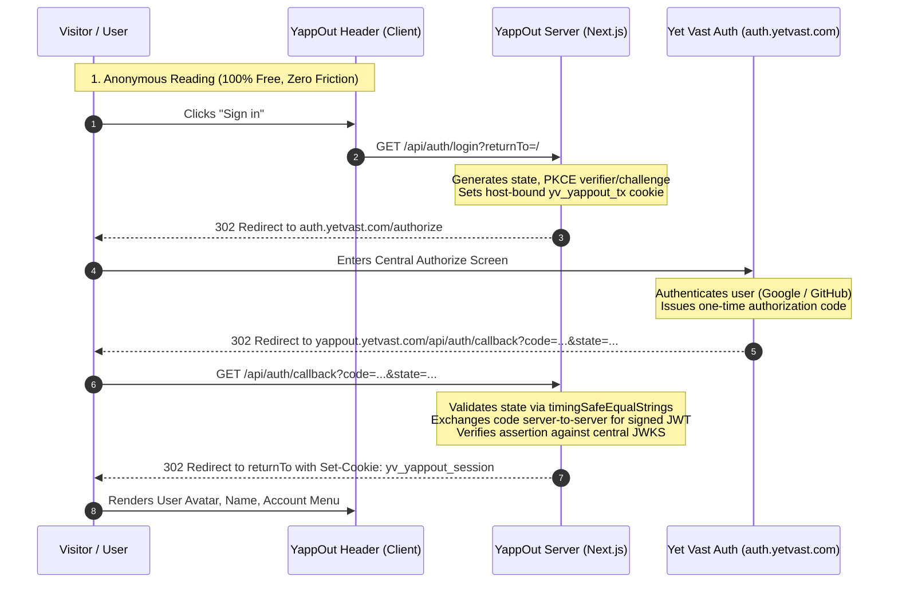

# Implementation Audit: YappOut — Central Yet Vast Auth SSO Integration

> **Document ID:** YVS-AUDIT-2026-11-16-YAPPOUT-SSO-INTEGRATION  
> **Repository:** `YetVastSolutions/yappout` (`https://yappout.yetvast.com`)  
> **Upstream Authority:** Yet Vast Auth (`https://auth.yetvast.com`)  
> **Date:** November 16, 2026  
> **Auditor:** Antigravity AI Engineering Assistant  
> **Standard:** `YVS-STD-2026-PKG-001`  
> **Status:** Implemented & Verified Locally; Production SSO Pending Central Registration  

---

## 1. Executive Summary

YappOut V0 is publicly deployed as an anonymous-first audio reader at `https://yappout.yetvast.com`. This integration establishes optional single sign-on (SSO) authentication with the central **Yet Vast Auth** authority (`https://auth.yetvast.com`), allowing users to connect their verified Yet Vast identity while preserving the zero-barrier, anonymous client-side reading engine.

---

## 2. Official `@yetvast/auth` SDK APIs Used

The integration is built strictly on top of the canonical `@yetvast/auth` (v0.2.0+) packages:

| SDK Module | API / Function | Purpose |
|---|---|---|
| `@yetvast/auth/server` | `createAppAuthorizeRedirect()` | Generates high-entropy OAuth `state` (24 bytes), PKCE `codeVerifier` (32 bytes), SHA-256 `codeChallenge`, and target authorize URL. |
| `@yetvast/auth/server` | `exchangeCodeForAssertion()` | Executes server-to-server POST to `https://auth.yetvast.com/api/token` exchanging the authorization code and verifier for a signed identity assertion JWT. |
| `@yetvast/auth/server` | `verifyApplicationAssertionJwt()` | Verifies asymmetric JWT signatures against central JWKS (`https://auth.yetvast.com/.well-known/jwks.json`), validating issuer, audience (`yappout`), and expiration. |
| `@yetvast/auth/server` | `assertServerRuntime()` | Runtime guard ensuring server-only auth routines cannot be executed or leaked into browser bundles. |
| `@yetvast/auth/server` | `timingSafeEqualStrings()` | Constant-time string comparison preventing timing attacks on OAuth `state` tokens. |
| `@yetvast/auth/server` | `buildSessionCookieHeader()` | Generates host-bound, `HttpOnly`, `SameSite=Lax`, `Secure` session cookies. |
| `@yetvast/auth/server` | `buildClearSessionCookieHeader()` | Generates headers that securely expire transaction and session cookies. |
| `@yetvast/auth/server` | `verifyCsrfAndOrigin()` | Verifies `Origin` and `Referer` headers on state-mutating endpoints (`POST /api/auth/logout`). |
| `@yetvast/auth/server` | `parseCookieHeader()` | Robust parsing of incoming HTTP request `Cookie` headers. |
| `@yetvast/auth` | `isSafeRedirectUri()` | Validates and sanitizes return paths to strictly prevent open-redirect vulnerabilities. |
| `@yetvast/auth` | `asApplicationId()` | Validates and brands application ID strings. |
| `@yetvast/auth` | `AuthError`, `toPublicAuthError()` | Typed domain error handling and safe error redaction for user-facing responses. |

---

## 3. End-to-End Authentication Architecture & Flow



---

## 4. User Interface Architecture

- **Unauthenticated State:**
  - Visible **Sign in** button with `LogIn` icon in header actions.
  - Clicking directly launches the central SSO flow (`/api/auth/login`).
  - No intrusive login modal or sign-in requirement is forced on the visitor.
- **Authenticated State:**
  - Displays user avatar circle with initial, display name or user ID, and identity badge (`Persistent` or `Ephemeral`).
  - Account dropdown menu (`AccountMenu`) shows verified identity metadata (`Yet Vast ID`, `Authority`, `Account Type`, `Provider`) and a **Sign out** button.
- **Expired Session State:**
  - Replaces avatar with a subtle "Session Expired" badge.
  - Clicking it instantly reconnects via `/api/auth/login`.
- **Zero V0 Mutation Invariant:**
  - Signing out or session expiry **never clears entered reading text, stops in-flight speech, or resets playback positions**.

---

## 5. Environment Variables & Tiered Configuration

Documented in [`.env.example`](file:///c:/Users/yviyv/yvscodes/YetVastSolutions/yappout/.env.example):

| Variable | Scope / Tier | Example / Production Value | Purpose |
|---|---|---|---|
| `NODE_AUTH_TOKEN` | Build-Time / CI/CD Only | `ghp_...` (GitHub Classic PAT) | Authorizes `npm ci` to download `@yetvast/*` private packages from GitHub Packages during Vercel build. |
| `YAPPOUT_ORIGIN` | Server-Side App Config | `https://yappout.yetvast.com` | Canonical public application origin. |
| `YAPPOUT_APP_ID` | Server-Side App Config | `yappout` | Registered application ID in central Yet Vast Auth. |
| `YAPPOUT_CLIENT_SECRET` | Server Secret (Optional) | *(Empty for public PKCE)* | Only used if registered as a confidential OAuth client. |
| `YETVAST_AUTH_ORIGIN` | Authority Configuration | `https://auth.yetvast.com` | Origin of the central Yet Vast Auth authority. |
| `YETVAST_AUTH_ISSUER` | Authority Configuration | `https://auth.yetvast.com` | Expected JWT `iss` claim. |
| `YETVAST_AUTH_JWKS_URL` | Authority Configuration | `https://auth.yetvast.com/.well-known/jwks.json` | Remote asymmetric key set URL for JWT verification. |
| `YETVAST_ALLOW_TEST_MODE` | Test Flags Only | `0` | Forbidden in production; used only in unit mock tests. |

---

## 6. Application Registration in Central Authority

### Status
- **Investigation Finding:** Inspection of central Yet Vast Auth records confirmed that `yappout` is **NOT yet registered** in the production database.

### Registration Requirements
To enable live OAuth authentication, a central administrator must create the application record in Yet Vast Auth (`https://auth.yetvast.com/admin`):

```json
{
  "applicationId": "yappout",
  "name": "YappOut",
  "allowedRedirectUris": [
    "https://yappout.yetvast.com/api/auth/callback",
    "http://localhost:3000/api/auth/callback"
  ],
  "primaryUrl": "https://yappout.yetvast.com",
  "enabledProviders": ["google"],
  "allowEphemeralGithub": false,
  "requirePersistentIdentity": true,
  "status": "APPROVED"
}
```

*Graceful Failure Handling:* If an unregistered application attempts authentication, Yet Vast Auth returns `APPLICATION_NOT_REGISTERED`. YappOut captures and normalizes this error via `normalizeCentralAuthError()`, displaying a clear, non-crashing banner to the user.

---

## 7. Security Controls & Invariants

1. **Host-Bound Cookies:** `Domain` attribute is never specified on `yv_yappout_session` or `yv_yappout_tx` cookies, preventing wildcard cookie leaks across `.yetvast.com`.
2. **Open-Redirect Defense:** Any `returnTo` parameter is validated strictly using `isSafeRedirectUri()`, rejecting targets like `//attacker.com` or `https://attacker.com`.
3. **CSRF Protection:** State parameter validated with constant-time equality (`timingSafeEqualStrings`). Logout endpoint enforces same-origin validation (`Origin` / `Referer`).
4. **No Trust in Client Claims:** User identity is established solely through cryptographic verification of the server-to-server JWT assertion against central JWKS.
5. **Zero Database Dependency:** YappOut maintains no internal user database or user records.

---

## 8. Test Execution & Quality Gates

All quality verification gates were executed locally:

- **Automated Tests:** `npm test` $\rightarrow$ **16 test files passed (16), 98 tests passed (98) (100%) in 8.70s**.
  - 58 tests validating V0 core mechanics (playback, seeking, speech adapter, scroll controller, gestures, formatting).
  - 40 tests validating V1 authentication layer (login redirect, PKCE challenge, state verification, JWKS verification, session lifecycle, CSRF logout, UI states).
- **TypeScript Typecheck:** `npm run typecheck` (`tsc --noEmit`) $\rightarrow$ **0 errors**.
- **ESLint Analysis:** `npm run lint` (`eslint .`) $\rightarrow$ **0 errors, 0 warnings**.
- **Production Build:** `npm run build` (Turbopack) $\rightarrow$ **Compiled in 1849ms; static routes prerendered, dynamic routes generated**.

---

## 9. Remaining Deployment Actions

1. **Central Application Registration:** Central administrator registers and approves `yappout` on `https://auth.yetvast.com/admin`.
2. **Vercel Environment Variables:** Ensure `YAPPOUT_ORIGIN=https://yappout.yetvast.com` and `NODE_AUTH_TOKEN` are configured in Vercel.
3. **Live Production SSO Verification:** Once registered and redeployed, execute a live browser test against `https://yappout.yetvast.com`.
