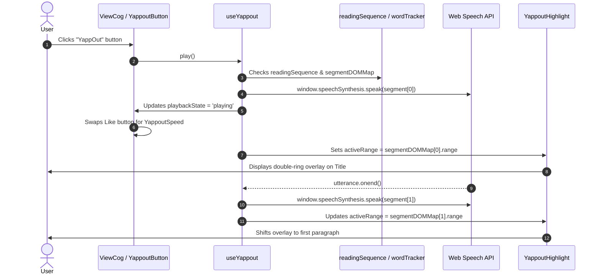
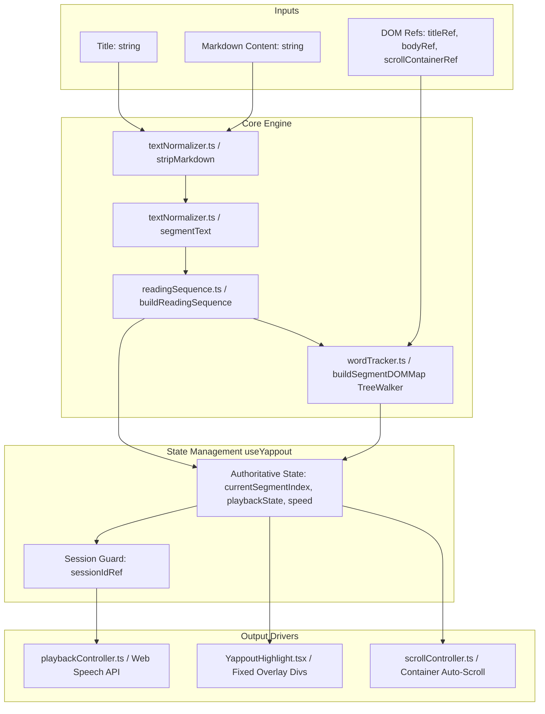
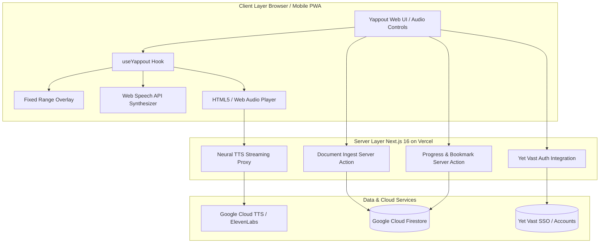
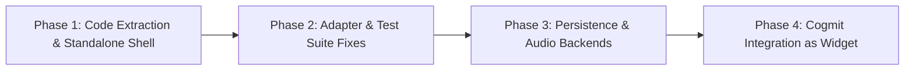

# YappOut: Standalone Project Extraction Documentation & Comprehensive Technical Audit

> **Document Type:** Reverse-Engineering Audit & Standalone Extraction Blueprint  
> **Target Product:** YappOut (Independent Text-to-Speech & Synchronized Visual Reader)  
> **Source Repository:** Cogmit (`YetVastSolutions/Cogmit`)  
> **Date of Audit:** November 16, 2026  
> **Author:** Antigravity AI Engineering Assistant (Google DeepMind)  
> **Status:** Extraction-Ready / Pre-Extraction Architectural Baseline  
> **Evidence Taxonomy:** `[OBSERVED]` (Source code inspection), `[TESTED]` (Executed commands/tests), `[DOCUMENTED]` (Existing documentation), `[INFERRED]` (Logical system derivation), `[PROPOSED]` (Target architecture), `[UNKNOWN]` (Unresolved/unverifiable).

---

## Table of Contents

1. [Executive Summary](#1-executive-summary)
2. [Product Definition and Vision](#2-product-definition-and-vision)
3. [Existing Implementation Status](#3-existing-implementation-status)
4. [Complete Functional Inventory](#4-complete-functional-inventory)
5. [User Journeys and Workflows](#5-user-journeys-and-workflows)
6. [Application Architecture](#6-application-architecture)
7. [UI/UX Architecture](#7-uiux-architecture)
8. [Authentication and Authorization](#8-authentication-and-authorization)
9. [Database and Data Models](#9-database-and-data-models)
10. [API and Server Action Inventory](#10-api-and-server-action-inventory)
11. [External Integrations](#11-external-integrations)
12. [Cogmit Dependency Analysis](#12-cogmit-dependency-analysis)
13. [Shared Infrastructure and Reusable Components](#13-shared-infrastructure-and-reusable-components)
14. [Standalone YappOut Target Architecture](#14-standalone-yappout-target-architecture)
15. [Proposed Repository Structure](#15-proposed-repository-structure)
16. [Environment Variables and Configuration](#16-environment-variables-and-configuration)
17. [Security and Data Isolation](#17-security-and-data-isolation)
18. [Testing and Quality Assessment](#18-testing-and-quality-assessment)
19. [Implementation Gaps](#19-implementation-gaps)
20. [Migration and Extraction Strategy](#20-migration-and-extraction-strategy)
21. [Future Product Roadmap](#21-future-product-roadmap)
22. [Technical Decisions and Architectural Invariants](#22-technical-decisions-and-architectural-invariants)
23. [Known Limitations and Risks](#23-known-limitations-and-risks)
24. [Appendix: Source File Inventory](#24-appendix-source-file-inventory)

---

## 1. Executive Summary

YappOut was initially developed and incubated inside the **Cogmit** application as an in-browser assistive reading and speech module. Its primary capability in Cogmit is providing synchronized Text-to-Speech (TTS) reading with visual sentence/clause highlighting over rendered Markdown documents without mutating the DOM or disturbing document layout.

As part of Yet Vast Solutions' product ecosystem evolution, YappOut is slated for complete extraction from Cogmit into an autonomous, standalone commercial application. This audit provides the complete reverse-engineered blueprint of YappOut's current code, architecture, execution mechanics, dependencies, defects, and target architecture.

### Key Audit Findings:
1. **Feature Maturity:** YappOut has a fully functional client-side continuous TTS reading and multi-line overlay highlighting engine (`src/yappout/`), featuring natural punctuation boundary segmentation, Web Speech API playback, smooth viewport auto-scrolling, speed cycling (`1×`, `1.5×`, `2×`, `0.5×`, `0.75×`), and double-tap/double-click seek detection.
2. **Persistence Independence:** In Cogmit, YappOut has **zero server-side database footprint** `[OBSERVED]`. Neither Firestore nor GitHub repositories store any YappOut state. It operates as an entirely in-memory, client-side session engine.
3. **Decoupling Feasibility:** The core YappOut engine (`src/yappout/core/`, `src/yappout/utils/`, `src/yappout/components/`) was intentionally built with low coupling. It depends primarily on a handful of UI tokens from `src/constants/index.ts` and a standard Shadcn/Base-UI button primitive.
4. **Current Incomplete / Blocked Work:**
   - In Cogmit's private workspace (`mode === "private"`), YappOut is hard-disabled `[OBSERVED]`.
   - The test suites (`scripts/test-yappout.mjs` and `src/yappout/tests/yappout.test.mjs`) fail immediately under direct Node.js execution due to an extensionless relative import in `src/yappout/core/speedController.ts` `[TESTED]`.
   - ESLint detects a React 19 `set-state-in-effect` error in `src/yappout/hooks/useYappout.ts:130` `[TESTED]`.
   - No audio synthesis options exist beyond client-side browser Web Speech API voices.

---

## 2. Product Definition and Vision

### 2.1 Product Definition
**YappOut** is an audio-first, multimodal reading platform that bridges written text and spoken narration. By combining synchronized visual highlight tracking with speech synthesis, YappOut transforms static long-form text (articles, Markdown documentation, newsletters, study notes) into an engaging, multi-sensory reading experience.

### 2.2 The Problem It Solves
1. **Reading Fatigue & Focus Drift:** Extended reading on screens causes cognitive fatigue, eye strain, and loss of attention.
2. **Monotone / Disconnected Screen Readers:** Native OS accessibility tools often sound mechanical, lose page context, or cannot visually anchor the user to where speech is occurring.
3. **DOM-Mutating Extension Failures:** Browser TTS extensions typically inject `<mark>` or `<span>` wrappers into HTML, frequently breaking code syntax highlighting, destroying inline styles, or invalidating virtual DOM structures.
4. **Lack of Dual-Modality Learning:** Neurodivergent readers (such as individuals with ADHD or dyslexia) and language learners benefit significantly from simultaneous auditory processing and visual pacing.

### 2.3 Intended Users
- **Knowledge Workers & Researchers:** Professionals digesting lengthy articles, reports, and documentation.
- **Developers & Technical Writers:** Engineers reviewing technical documentation, RFCs, and markdown notes while cross-referencing code.
- **Language Learners & Students:** Learners seeking pronunciation confirmation and rhythmic text pacing.
- **Neurodivergent Readers:** Readers requiring active focal cues to maintain reading trajectory and prevent line-skipping.

### 2.4 Core Value Proposition
- **Zero-DOM-Mutation Highlighting:** Renders a floating, non-invasive overlay using exact browser `Range.getClientRects()`, guaranteeing 100% layout and DOM fidelity.
- **Natural Clause Segmentation:** Parses text by human clause boundaries rather than arbitrary token chunks or single words, resulting in fluid pacing.
- **Interactive Spatial Seeking:** Direct double-click or mobile double-tap on any word or clause immediately re-anchors playback to that exact point.
- **Distraction-Free Focus:** Keeps the current passage centered smoothly in the viewport with configurable buffer boundaries.

### 2.5 Differences Between YappOut and Cogmit

| Dimension | Cogmit | YappOut (Standalone Target) |
| :--- | :--- | :--- |
| **Primary Domain** | Personal Knowledge Management (PKM) & Social Publishing | Multimodal Audio-Visual Reading & Speech Consumption |
| **Core Entity** | Cog (hierarchical Markdown document with cards & projects) | Read / Document / Playlist / Audio Track |
| **Persistence Store** | GitHub API (`YVSApps_Data_Cogmit_*`) via Octokit | Dedicated Database (Firestore / Document Store) |
| **Input Sources** | In-app Markdown editor, RootCog imports | URLs, Markdown, Text, EPUB, PDF, RSS, Cogmit exports |
| **Output Media** | Visual cards, Web pages, Social metadata embeds | Audio streams, Synchronized transcripts, Exported audio |
| **Target Platforms** | Desktop/Web knowledge portal | Responsive Web App, PWA, Browser Extension, Mobile App |

### 2.6 Relationship Between YappOut and Cogmit
In Cogmit, YappOut served as a feature module for published Cogs. In the extracted architecture, **YappOut becomes an independent Yet Vast Solutions platform**. Cogmit will consume YappOut as an embedded reader widget or linked service, while YappOut operates as an autonomous application with its own ingestion pipeline, user library, and audio synthesis backends.

---

## 3. Existing Implementation Status

### 3.1 Codebase Overview
In the current Cogmit repository, YappOut exists as a modular feature package situated in `src/yappout/`:

```
src/yappout/
├── index.ts                           # Barrel export for module
├── README.md                          # Existing technical documentation
├── adapters/
│   ├── cogmitContentAdapter.ts        # Content extraction helper
│   └── speechSynthesisAdapter.ts      # Web Speech API wrapper abstraction
├── components/
│   ├── YappoutButton.tsx              # Primary play/stop toggle button
│   ├── YappoutHighlight.tsx           # Multi-line fixed overlay highlight
│   ├── YappoutSegment.tsx             # Inline segment wrapper (alternative view)
│   ├── YappoutSpeed.tsx               # Speed cycler button
│   └── YappoutWord.tsx                # Inline word wrapper (legacy/word mode)
├── core/
│   ├── playbackController.ts          # Segment-by-segment speech controller
│   ├── readingSequence.ts             # Reading sequence construction from title/body
│   ├── scrollController.ts            # Viewport auto-scroll logic
│   ├── seekController.ts              # Seek request types
│   ├── speedController.ts             # Speed cycling logic & constants
│   └── wordTracker.ts                 # DOM TreeWalker range mapping & caret matching
├── hooks/
│   └── useYappout.ts                  # Primary React hook orchestrating all state
├── styles/
│   └── yappout.css                    # Scoped styles for highlight & buttons
├── tests/
│   └── yappout.test.mjs               # Minimal unit test suite
└── utils/
    ├── doubleTapDetector.ts           # Touch and mouse gesture detector
    ├── markdownExtractor.ts           # Markdown stripping & paragraph extractor
    └── textNormalizer.ts              # Markdown stripping & clause/delimiter tokenizer
```

### 3.2 Cogmit Touchpoints
YappOut is touched outside of `src/yappout/` in exactly four locations:
1. `src/components/ViewCog.tsx` `[OBSERVED]`: Integrates `useYappout`, `YappoutButton`, `YappoutSpeed`, `YappoutHighlight`, and toolbar items.
2. `src/components/CogWorkspaceShell.tsx` `[OBSERVED]`: Passes `scrollContainerRef` to the scrollable content container.
3. `src/constants/index.ts` `[OBSERVED]`: Defines scroll margins, double-tap tolerances, speed cycles, and brand colors.
4. `src/app/globals.css` `[OBSERVED]`: Contains duplicate declarations of `.yappout-*` CSS classes.

---

## 4. Complete Functional Inventory

The following table details every feature identified in the current implementation:

| ID | Feature Name | Classification | Purpose | Source File(s) | Dependencies |
| :--- | :--- | :--- | :--- | :--- | :--- |
| **F-01** | **Continuous Segment Playback** | `IMPLEMENTED` | Sequentially synthesizes sentences/clauses using Web Speech API | `playbackController.ts`, `useYappout.ts` | `window.speechSynthesis` |
| **F-02** | **Session-Guarded Playback** | `IMPLEMENTED` | Invalidates stale async TTS callbacks during rapid seeks/stops | `playbackController.ts`, `useYappout.ts` | JavaScript closures, `useRef` |
| **F-03** | **Non-Mutating Overlay Highlighting** | `IMPLEMENTED` | Renders fixed-position visual highlight boxes over the active segment | `YappoutHighlight.tsx`, `wordTracker.ts` | `Range.getClientRects()`, DOM Range |
| **F-04** | **Natural Boundary Segmentation** | `IMPLEMENTED` | Splits text on sentence/clause punctuation (`. , ? ! : ; … — –`) while preserving abbreviations & decimals | `textNormalizer.ts` | Pure TypeScript regex logic |
| **F-05** | **Markdown Content Stripping** | `IMPLEMENTED` | Strips syntax markers (headings, code blocks, links, bold) while preserving readable words | `textNormalizer.ts`, `markdownExtractor.ts` | Pure regex |
| **F-06** | **DOM TreeWalker Range Mapping** | `IMPLEMENTED` | Traverses rendered DOM text nodes and constructs accurate `Range` objects for text segments | `wordTracker.ts` | `document.createTreeWalker` |
| **F-07** | **Viewport Auto-Scroll** | `IMPLEMENTED` | Keeps the currently read segment visible with an 80px margin buffer | `scrollController.ts`, `useYappout.ts` | `HTMLElement.scrollTo` |
| **F-08** | **Speed Cycling Control** | `IMPLEMENTED` | Cycles playback rate through `1× -> 1.5× -> 2× -> 0.5× -> 0.75×` without losing segment index | `speedController.ts`, `YappoutSpeed.tsx`, `useYappout.ts` | `src/constants/index.ts` |
| **F-09** | **Coordinate Caret Seeking** | `IMPLEMENTED` | Maps screen coordinates $(x, y)$ from double-tap/click to segment index | `wordTracker.ts`, `doubleTapDetector.ts`, `useYappout.ts` | `document.caretRangeFromPoint`, `Range.comparePoint` |
| **F-10** | **Play / Stop Toolbar Toggle** | `IMPLEMENTED` | UI button to initiate or cancel playback | `YappoutButton.tsx`, `ViewCog.tsx` | Base UI / Shadcn Button |
| **F-11** | **Adaptive Toolbar Placement** | `IMPLEMENTED` | In Cogmit mode, swaps Like button with Speed button during playback | `ViewCog.tsx` | `ResponsiveActionGroups.tsx` |
| **F-12** | **Title-to-Body Reading Flow** | `IMPLEMENTED` | Sequences title segments first, followed seamlessly by body segments | `readingSequence.ts`, `useYappout.ts` | `textNormalizer.ts` |
| **F-13** | **Touch Double-Tap Gesture** | `IMPLEMENTED` | Detects mobile double-tap within 300ms and 20px slop | `doubleTapDetector.ts` | Touch events (`touchend`) |
| **F-14** | **Speech Synthesis Adapter** | `PARTIALLY IMPLEMENTED` | Defines wrapper interface for speech engines; exists but is bypassed by playback controller | `speechSynthesisAdapter.ts` | None (standalone module) |
| **F-15** | **Content Extraction Adapter** | `PARTIALLY IMPLEMENTED` | Intended to extract title/body from host documents; exists as a pass-through | `cogmitContentAdapter.ts` | None |
| **F-16** | **Inline Span Wrapping** | `UI ONLY` | Inline segment/word span wrappers for direct DOM embedding | `YappoutSegment.tsx`, `YappoutWord.tsx` | React inline components |
| **F-17** | **Private Mode Playback** | `NOT IMPLEMENTED` | In Cogmit draft mode, Yappout is completely disabled with a tooltip | `ViewCog.tsx:290-297` | Requires Cogmit architecture refactor |
| **F-18** | **Reading Progress Persistence** | `NOT IMPLEMENTED` | Saving current segment position across sessions | None | Requires database/local storage |
| **F-19** | **Voice Selection & Customization** | `NOT IMPLEMENTED` | Selecting voice gender, pitch, accent, or cloud neural voices | Hardcoded to `'en-US'` in `playbackController.ts` | Requires Web Speech Voice API |
| **F-20** | **Pause / Resume** | `NOT IMPLEMENTED` | Pausing playback without resetting to segment 0 | Playback can only `stop` or restart | Requires state machine update |

---

## 5. User Journeys and Workflows

### 5.1 Journey 1: Initial Playback from Top


### 5.2 Journey 2: Interactive Double-Click / Double-Tap Seeking
1. **User Action:** While listening to segment 2, the user spots an interesting paragraph further down the page (segment 8).
2. **Gesture:** The user double-clicks (desktop) or double-taps (touchscreen) on the target text.
3. **Hit Testing:** `attachDoubleTapHandler` captures client coordinates $(x, y)$.
4. **Caret Mapping:** `getCaretRangeFromPoint(x, y)` generates a collapsed DOM Range.
5. **Segment Resolution:** `findSegmentIndexFromCaretRange` walks `segmentDOMMap` using `range.comparePoint(caretNode, caretOffset)` to determine that the click falls within segment 8.
6. **Session Transition:** `seekTo(8)`:
   - Increments `sessionIdRef.current`.
   - Calls `window.speechSynthesis.cancel()` to abort current audio.
   - Sets `currentSegmentIndex` to 8.
   - Dispatches `speakSegmentBySegment(segments, 8, rate, newSessionId, ...)`.
7. **Visual & Scroll Alignment:**
   - Active highlight overlay smoothly animates/repositions to segment 8.
   - `scrollSegmentIntoView` calculates container bounds and scrolls segment 8 into centered view with 80px margin.

### 5.3 Journey 3: In-Flight Speed Cycling
1. **User Action:** User clicks the `YappoutSpeed` button (`1×`).
2. **State Transition:** `cycleSpeed()` computes `nextSpeedIdx(0) -> 1` (`1.5×`).
3. **Session Re-anchoring:**
   - Because `playbackState === 'playing'`, the hook cancels active synthesis.
   - Increments `sessionIdRef.current`.
   - Immediately resumes playback from `currentSegmentIndexRef.current` at `rate = 1.5`.
4. **Result:** The user experiences a seamless tempo acceleration without being thrown back to the beginning of the article.

---

## 6. Application Architecture

### 6.1 Architectural Principles
YappOut was designed around four critical architectural invariants:
1. **Non-Invasive Visual Layer:** Under no circumstances should YappOut modify the inner HTML or React component tree of the rendered content. Doing so would conflict with third-party Markdown parsers, destroy syntax highlighting, and cause layout thrashing.
2. **Authoritative Segment State:** A single integer (`currentSegmentIndex`) governs speech progression, DOM range calculation, visual highlight coordinates, and auto-scrolling.
3. **Session-Guarded Asynchrony:** Browser speech synthesis callbacks (`onend`, `onerror`) are inherently asynchronous and notorious for firing out-of-order when cancelled. Every operation uses monotonic `sessionId` tokens to reject zombie callbacks.
4. **Zero-Latency Touch Resiliency:** Touch and mouse interactions utilize native browser caret APIs (`caretRangeFromPoint`, `caretPositionFromPoint`) with tree-containment fallbacks.

### 6.2 Data Flow Diagram



### 6.3 Detailed Component Responsibilities

#### 1. Text Normalizer & Segmenter (`src/yappout/utils/textNormalizer.ts`)
- **`stripMarkdown(markdown: string): string`**:
  - Removes fenced code blocks (```` ``` ````), inline code (`` ` ``), Markdown images (`` -> `alt`), Markdown links (`[text](url)` -> `text`), headings (`#`), bold/italic (`**`, `*`, `__`, `_`), strikethrough (`~~`), blockquotes (`>`), horizontal rules (`---`), and HTML tags.
  - Preserves intra-word apostrophes, commas, periods, currency symbols, and numeric formatting.
- **`segmentText(text: string, section, startIndex): SegmentToken[]`**:
  - Splits text into readable chunks on delimiters: `. , ? ! : ; … — –` and fullwidth equivalents `。 ， 、 ！ ？ ： ；`.
  - **Decimal & Time Protection:** Regex check `\d[.,:]\d` ensures `3.14`, `10,000`, and `10:30` are treated as contiguous tokens.
  - **Abbreviation Protection:** Recognizes titles (`Dr.`, `Mr.`, `Ms.`, `Prof.`) and Latin abbreviations (`e.g.`, `i.e.`, `etc.`).
  - **Quote Attachment:** Trailing closing marks (`" ' ” ’ ) ] }`) remain bound to the preceding segment.

#### 2. DOM Range Builder (`src/yappout/core/wordTracker.ts`)
- **`buildSegmentDOMMap(titleEl, bodyEl, segments): SegmentDOMMap`**:
  - Uses `document.createTreeWalker(el, NodeFilter.SHOW_TEXT)` to collect all text nodes.
  - Flattens text nodes into a continuous character string while preserving an offset index map `{ node: Text, start: number, end: number }`.
  - Performs exact string matching (`indexOf`) using an advancing cursor.
  - **Word-Sequence Fallback:** If exact string matching fails (due to HTML character entities, collapsed whitespace, or formatting variations across parsers), it splits the segment into individual words and matches the sequence with a 100-character proximity threshold.
  - Returns an array of `{ segmentIndex, range: Range, text }`.

#### 3. Overlay Renderer (`src/yappout/components/YappoutHighlight.tsx`)
- Does not wrap DOM elements. Instead, it queries `activeRange.getClientRects()`.
- If a segment wraps across 3 lines of text, `getClientRects()` returns 3 distinct rectangles.
- Renders 3 floating `<div />` elements with:
  - `position: fixed`
  - `pointer-events: none`
  - `z-index: 9000`
  - `outline: 2px solid #FFFF11` (YVS Yellow)
  - `box-shadow: 0 0 0 4px #4B0084` (YVS Indigo-Violet)
  - Responsive positioning via passive `scroll` and `resize` listeners.

#### 4. Auto-Scroll Controller (`src/yappout/core/scrollController.ts`)
- Computes `segmentRect` relative to `containerRect`.
- Employs `YAPPOUT_SCROLL_MARGIN = 80px`.
- If the segment approaches within 80px of the visible viewport ceiling or floor, smooth scrolling is triggered to reposition the segment into comfortable reading focus.

---

## 7. UI/UX Architecture

### 7.1 Visual Design Tokens & Theming
YappOut conforms to Yet Vast Solutions Design Guidelines:
- **Brand Colors:**
  - Inner Highlight: `YVS Yellow` (`#FFFF11`)
  - Outer Box-Shadow: `YVS Indigo-Violet` (`#4B0084`)
  - Neutral Background: `#FFFFFF` (Light), `#09060D` (Dark)
  - Neutral Text: `#17121C` (Light), `#F8F5FA` (Dark)
- **Typography:**
  - Speed label button enforces tabular figures (`font-variant-numeric: tabular-nums`) to prevent layout jitter when switching between `1×` and `0.75×`.
- **Button Styling:**
  - Built with Base-UI primitives using CVA (Class Variance Authority) with subtle hover brightness transitions.

### 7.2 UI State States

| State | YappoutButton | YappoutSpeed | YappoutHighlight | Viewport Behavior |
| :--- | :--- | :--- | :--- | :--- |
| **Idle** | Text "YappOut", Volume2 icon | Hidden (Like button visible) | None (null) | Normal user scrolling |
| **Playing** | Text "Stop", Square icon | Visible (`1×`, `1.5×`, etc.) | Dual-ring outline on active segment | Auto-scroll tracks active segment |
| **Paused** | *(Not currently supported)* | *(Not currently supported)* | *(Not currently supported)* | *(Not currently supported)* |
| **Stopped** | Text "YappOut", Volume2 icon | Hidden | Cleared | Scroll position preserved |
| **Completed**| Text "YappOut", Volume2 icon | Hidden | Cleared | Resets index to 0 |

---

## 8. Authentication and Authorization

### 8.1 Current Implementation in Cogmit `[OBSERVED]`
- **Authentication Engine:** Cogmit uses NextAuth v5 beta (`@auth/core` / `next-auth`) with GitHub OAuth (`read:user`, `user:email`, `repo`).
- **Authorization Gating:**
  - In `src/components/ViewCog.tsx:290-297`, YappOut is hard-disabled when `mode === "private"` (Cogmit draft mode).
  - In `mode === "cogmit"` (public published view), YappOut is accessible to **all users unconditionally** (both anonymous visitors and authenticated authors).
  - YappOut itself performs **zero authentication checks, session cookie reads, or user permission evaluations**. It is an unauthenticated client feature.

### 8.2 Target Authentication Architecture for Standalone YappOut `[PROPOSED]`
Standalone YappOut must transition from an embedded passive reader to an independent platform:
1. **Central Yet Vast Auth Integration:**
   - Standalone YappOut should authenticate against Yet Vast Solutions' centralized OAuth / SSO service (`auth.yetvast.com` or Firebase Auth).
   - Session management via HTTP-only, secure, `SameSite=Lax` cookies.
2. **Anonymous vs. Authenticated Tiers:**
   - **Anonymous Tier:** Users can listen to public links, paste text for immediate reading, and cycle local speeds. No server persistence.
   - **Registered User Tier:** Cross-device reading history, saved library, custom voice preferences, cloud neural TTS credits, and bookmark sync.
3. **Authorization Boundaries:**
   - Public documents: Open read.
   - User Private Library: Strict owner-only access validated on server actions / API endpoints via user ID token.

---

## 9. Database and Data Models

### 9.1 Existing Persistence in Cogmit `[OBSERVED]`
**There are NO Firestore collections, SQL tables, or GitHub files storing YappOut data in Cogmit.**  
All state exists purely in React memory:
```typescript
// Ephemeral in-memory hook state (useYappout.ts)
const [playbackState, setPlaybackState] = useState<PlaybackState>('idle');
const [currentSegmentIndex, setCurrentSegmentIndex] = useState(0);
const [speedCycleIdx, setSpeedCycleIdx] = useState(DEFAULT_SPEED_IDX);
const [segmentDOMMap, setSegmentDOMMap] = useState<SegmentDOMMap>([]);
```

### 9.2 Target Database Architecture for Standalone YappOut `[PROPOSED]`
When standalone YappOut is provisioned, it requires a persistence layer to support user libraries, saved reading progress, and playlists. The recommended architecture leverages **Firestore** (in alignment with Yet Vast ecosystem standards):

#### Proposed Firestore Schema:

```
firestore/
├── users/
│   └── {userId}/
│       ├── profile: { email, displayName, createdAt }
│       └── preferences: { defaultSpeed, preferredVoiceId, autoScrollEnabled, theme }
│
├── documents/
│   └── {documentId}/
│       ├── ownerId: string ("system" | userId)
│       ├── title: string
│       ├── originalContent: string (Markdown / HTML / Plaintext)
│       ├── strippedContent: string
│       ├── sourceUrl?: string
│       ├── totalSegments: number
│       ├── totalWords: number
│       ├── estimatedReadingTimeSec: number
│       ├── visibility: "public" | "unlisted" | "private"
│       ├── createdAt: Timestamp
│       └── updatedAt: Timestamp
│
└── readingSessions/
    └── {sessionId}/
        ├── userId: string
        ├── documentId: string
        ├── lastSegmentIndex: number
        ├── percentCompleted: number
        ├── isCompleted: boolean
        ├── lastPlaybackRate: number
        ├── lastListenedAt: Timestamp
        └── bookmarks: Array<{ segmentIndex: number, note?: string, createdAt: Timestamp }>
```

#### Representative TypeScript Data Contracts:

```typescript
export interface UserPreferences {
  defaultSpeed: number;           // e.g. 1.0, 1.5
  preferredVoiceId: string;       // e.g. "Google US English", "en-US-Neural2-F"
  autoScrollEnabled: boolean;
  theme: 'light' | 'dark' | 'system';
}

export interface YappoutDocument {
  id: string;
  ownerId: string;
  title: string;
  content: string;
  sourceUrl?: string;
  metadata: {
    totalSegments: number;
    totalWords: number;
    readingTimeSeconds: number;
    contentType: 'markdown' | 'text' | 'html';
  };
  visibility: 'public' | 'unlisted' | 'private';
  createdAt: string;
  updatedAt: string;
}

export interface ReadingProgressRecord {
  id: string;
  userId: string;
  documentId: string;
  lastSegmentIndex: number;
  percentCompleted: number;
  isCompleted: boolean;
  playbackRate: number;
  updatedAt: string;
}
```

---

## 10. API and Server Action Inventory

### 10.1 Existing Endpoints `[OBSERVED]`
**There are zero API endpoints or Server Actions dedicated to YappOut in Cogmit.**  
All operations run exclusively in the browser thread via Web Speech API and DOM manipulation.

### 10.2 Target Standalone API Architecture `[PROPOSED]`

| Endpoint / Action | Method | Description | Auth Required | Payload | Response |
| :--- | :--- | :--- | :--- | :--- | :--- |
| `POST /api/documents` | Server Action | Ingests a new document (URL, text, or markdown) | Optional | `{ title, content, sourceUrl? }` | `{ documentId, totalSegments }` |
| `GET /api/documents/[id]` | Route Handler | Fetches a document and its pre-parsed segments | Public / Owner | None | `YappoutDocument` |
| `POST /api/progress` | Server Action | Saves reading progress / bookmark | Authenticated | `{ documentId, segmentIndex, isCompleted }` | `{ success: true }` |
| `GET /api/progress/[docId]` | Route Handler | Retrieves user's last reading position | Authenticated | None | `ReadingProgressRecord` |
| `POST /api/tts/synthesize` | Route Handler | (Optional) Synthesizes neural audio for high-fidelity tier | Authenticated | `{ text, voiceId, rate }` | Audio stream (`audio/mpeg`) |

---

## 11. External Integrations

### 11.1 Current External Integrations `[OBSERVED]`
1. **Web Speech API (`window.speechSynthesis`, `SpeechSynthesisUtterance`):**
   - Built into modern web browsers (Chrome, Edge, Safari, Firefox).
   - Requires no external API keys, tokens, or network requests.
   - Operates entirely offline on supported client platforms.
2. **Lucide React Icons:**
   - Supplies `Volume2` and `Square` icons for the play/stop toggle.
3. **Base UI / Shadcn UI:**
   - Provides accessible button primitives.

### 11.2 Target Standalone Integrations `[PROPOSED]`
1. **Cloud Neural Speech Synthesis (Tier 2 Audio):**
   - Google Cloud Text-to-Speech API or ElevenLabs for studio-grade natural voices.
   - Requires server-side proxying and API credentials (`GOOGLE_TTS_API_KEY` / `ELEVENLABS_API_KEY`).
2. **Article Extractor / Parser:**
   - Mozilla Readability or `@extractus/article-extractor` to parse arbitrary news/blog URLs into clean markdown/text for listening.
3. **Yet Vast Auth SSO:**
   - Central authentication service for Yet Vast ecosystem accounts.

---

## 12. Cogmit Dependency Analysis — Critical

To safely extract YappOut, every touchpoint between YappOut and Cogmit must be categorized and analyzed.

### 12.1 Dependency Matrix

| Component / Utility | Current Location in Cogmit | Classification | Coupling Level | Action for Standalone Extraction |
| :--- | :--- | :--- | :--- | :--- |
| **Core Yappout Engine** | `src/yappout/core/*` | **A. YappOut-Specific** | None | Move directly into standalone repository `src/core/` |
| **Yappout Utilities** | `src/yappout/utils/*` | **A. YappOut-Specific** | Low | Move into `src/utils/`; resolve duplicate `stripMarkdown` |
| **Yappout Components** | `src/yappout/components/*` | **A. YappOut-Specific** | Low | Move into `src/components/`; decouple from Cogmit button |
| **Constants & Tokens** | `src/constants/index.ts` | **C. Shared Infrastructure** | Medium | Extract Yappout tokens into standalone `src/constants/yappout.ts` |
| **Overlay Highlight CSS** | `src/yappout/styles/yappout.css` | **A. YappOut-Specific** | None | Move into standalone `src/styles/yappout.css` or CSS Modules |
| **ViewCog Host Container** | `src/components/ViewCog.tsx` | **B. Cogmit-Specific** | High | Do NOT transfer. Replace with standalone `ReadingWorkspace.tsx` |
| **CogWorkspaceShell** | `src/components/CogWorkspaceShell.tsx` | **B. Cogmit-Specific** | High | Do NOT transfer. Build dedicated `YappoutShell.tsx` |
| **ResponsiveActionGroups** | `src/components/ResponsiveActionGroups.tsx`| **B. Cogmit-Specific** | High | Do NOT transfer. Build focused audio player controls |
| **GitHub Storage / Octokit** | `src/lib/github.ts` | **B. Cogmit-Specific** | Total | Do NOT transfer. YappOut does not use GitHub storage |
| **Card Renderer & Fonts** | `src/lib/card-renderer.ts` | **B. Cogmit-Specific** | Total | Do NOT transfer. Belongs exclusively to Cogmit card engine |
| **NextAuth GitHub Auth** | `src/auth.ts` | **B. Cogmit-Specific** | High | Do NOT transfer. Use Yet Vast Auth / Firebase Auth |
| **Excerpt Generator** | `src/lib/excerpt.ts` | **C. Shared Infrastructure** | Low | Consolidate Markdown stripping into Yappout's text utility |
| **Shadcn Button Component** | `src/components/ui/button.tsx` | **C. Shared Infrastructure** | Low | Re-implement standard Base-UI / Tailwind button in standalone |

### 12.2 Detailed Breakdown of Coupled Areas

#### 1. Constants & Brand Colors (`src/constants/index.ts`)
- **Current Coupling:** `speedController.ts`, `scrollController.ts`, `doubleTapDetector.ts`, and `YappoutHighlight.tsx` import `YAPPOUT_SCROLL_MARGIN`, `YAPPOUT_DOUBLE_TAP_DELAY`, `YAPPOUT_TAP_SLOP`, `SPEED_CYCLE`, `COLOR_YELLOW`, and `COLOR_INDIGO_VIOLET` from `@/constants`.
- **Extraction Resolution:** Create a dedicated, self-contained `src/constants/index.ts` in the new YappOut repository containing only YappOut tokens and brand color standards.

#### 2. Host Viewport & Ref Binding (`ViewCog.tsx` & `CogWorkspaceShell.tsx`)
- **Current Coupling:** `useYappout` expects three DOM refs: `titleRef`, `bodyRef`, and `scrollContainerRef`. In Cogmit, these refs are passed manually through `CogWorkspaceShell` and bound to the `h1` and rendered markdown container.
- **Extraction Resolution:** In standalone YappOut, the reading canvas will be owned by a dedicated `YappoutCanvas` component that automatically manages and wires these refs internally.

---

## 13. Shared Infrastructure and Reusable Components

The following modules from Yet Vast Solutions infrastructure can be reused or adapted:

1. **Design System & Tokens:**
   - YVS Brand Colors: Indigo-Violet (`#4B0084`) and Yellow (`#FFFF11`).
   - Base UI primitive buttons with CVA styling.
2. **Text Processing Pipeline:**
   - The robust markdown-stripping and punctuation segmentation algorithm (`textNormalizer.ts`) should become a shared Yet Vast npm package or internal utility.
3. **Cross-Platform Touch & Gesture Library:**
   - `doubleTapDetector.ts` provides reusable touch-slop and timing logic suitable across mobile apps.

---

## 14. Standalone YappOut Target Architecture

### 14.1 Technology Stack Recommendations
- **Framework:** Next.js 16+ (App Router, Server Actions, React 19).
- **Language:** TypeScript 5+ (Strict mode).
- **Styling:** CSS Modules + Vanilla CSS Variables (or Tailwind CSS v4 in alignment with Cogmit, strictly preserving YVS design tokens).
- **UI Primitives:** Base UI (`@base-ui/react`) / Lucide React.
- **Audio Engine:**
  - Client Tier: Native Web Speech API with SpeechSynthesisAdapter.
  - Cloud Tier: Web Audio API playback of streaming neural audio (Opus/MP3).
- **Database:** Google Cloud Firestore (Yet Vast standard).
- **Hosting & Deployment:** Vercel (Edge network, automated CI/CD).

### 14.2 High-Level System Architecture



---

## 15. Proposed Repository Structure

A clean, modular repository layout for standalone YappOut:

```
yappout/
├── .env.example
├── .gitignore
├── README.md
├── package.json
├── tsconfig.json
├── next.config.ts
├── eslint.config.mjs
├── public/
│   ├── favicon.ico
│   ├── icons/
│   └── og-image.png
│
├── src/
│   ├── app/
│   │   ├── globals.css                # Global styles & CSS variables
│   │   ├── layout.tsx                 # Root layout with Auth & Theme providers
│   │   ├── page.tsx                   # Landing page & quick-listen canvas
│   │   ├── library/                   # User's saved reads & history
│   │   │   └── page.tsx
│   │   ├── listen/
│   │   │   └── [documentId]/          # Dedicated full-screen reader workspace
│   │   │       └── page.tsx
│   │   └── api/
│   │       ├── auth/                  # Yet Vast Auth endpoints
│   │       ├── documents/             # Document ingestion & retrieval
│   │       └── tts/                   # Streaming neural speech synthesis
│   │
│   ├── components/
│   │   ├── player/
│   │   │   ├── AudioControls.tsx      # Play, pause, stop, speed, scrub controls
│   │   │   ├── SpeedSelector.tsx      # Refactored YappoutSpeed
│   │   │   └── VoiceSelector.tsx      # Voice picker dropdown
│   │   ├── reader/
│   │   │   ├── ReadingCanvas.tsx      # Houses document title, body & ref management
│   │   │   └── HighlightOverlay.tsx   # Refactored YappoutHighlight
│   │   └── ui/
│   │       ├── button.tsx
│   │       ├── modal.tsx
│   │       └── slider.tsx             # Audio scrubbing / progress slider
│   │
│   ├── core/
│   │   ├── playbackController.ts      # Multi-engine playback controller
│   │   ├── readingSequence.ts         # Segment & token builder
│   │   ├── scrollController.ts        # Dynamic viewport centering
│   │   ├── seekController.ts          # Coordinate & segment seeking
│   │   ├── speedController.ts         # Speed values & cycle logic
│   │   └── domTracker.ts              # Refactored wordTracker TreeWalker engine
│   │
│   ├── adapters/
│   │   ├── speech/
│   │   │   ├── WebSpeechAdapter.ts    # Native browser speech wrapper
│   │   │   └── CloudAudioAdapter.ts   # Web Audio / HTML5 audio stream player
│   │   └── content/
│   │       ├── MarkdownParser.ts      # Markdown stripping & normalization
│   │       └── UrlIngestor.ts         # HTML article scraping & cleaning
│   │
│   ├── hooks/
│   │   ├── useYappout.ts              # Refactored core coordinator hook
│   │   ├── useReadingProgress.ts      # Firestore sync hook
│   │   └── useDoubleTap.ts            # Extracted gesture hook
│   │
│   ├── constants/
│   │   ├── config.ts                  # Timing, margins, speed options
│   │   └── tokens.ts                  # Colors (#FFFF11, #4B0084), typography
│   │
│   ├── lib/
│   │   ├── firebase.ts                # Firestore client initialization
│   │   └── utils.ts                   # Class merging & general utilities
│   │
│   └── types/
│       ├── document.ts                # Document data contracts
│       ├── session.ts                 # Reading session & progress types
│       └── tts.ts                     # Engine, voice & callback signatures
│
└── tests/
    ├── unit/
    │   ├── segmentation.test.ts       # Delimiter & abbreviation tests
    │   ├── speed.test.ts              # Speed cycle tests
    │   └── normalizer.test.ts         # Markdown stripping tests
    └── e2e/
        └── reader-flow.spec.ts        # Playback, seeking & scroll tests
```

---

## 16. Environment Variables and Configuration

Standalone YappOut will require the following environment configuration (`.env.example`):

```bash
# ==============================================================================
# YappOut Application Environment Configuration
# ==============================================================================

# Public Application URL
NEXT_PUBLIC_APP_URL=http://localhost:3000

# Yet Vast Auth / Authentication Secret
AUTH_SECRET=your_auth_secret_here
AUTH_YETVAST_CLIENT_ID=your_yetvast_client_id_here
AUTH_YETVAST_CLIENT_SECRET=your_yetvast_client_secret_here

# Google Cloud Firebase / Firestore (Database & Persistence)
FIREBASE_PROJECT_ID=yappout-prod
FIREBASE_CLIENT_EMAIL=firebase-adminsdk@yappout-prod.iam.gserviceaccount.com
FIREBASE_PRIVATE_KEY=your_firebase_private_key_here
NEXT_PUBLIC_FIREBASE_API_KEY=your_public_firebase_api_key
NEXT_PUBLIC_FIREBASE_AUTH_DOMAIN=yappout.firebaseapp.com

# Optional Cloud Neural Speech Synthesis (High-Fidelity Tier)
GOOGLE_TTS_API_KEY=your_google_cloud_tts_api_key_here
ELEVENLABS_API_KEY=your_elevenlabs_api_key_here
```

---

## 17. Security and Data Isolation

### 17.1 Client-Side Protections
1. **DOM Injection Immunity:**
   - YappOut does not parse or execute scripts contained within read text.
   - All text rendered into the highlight overlay is purely measured for layout dimensions (`Range.getClientRects()`); no user string is placed inside `dangerouslySetInnerHTML`.
2. **Web Speech API Isolation:**
   - Browser speech synthesis operates within the origin sandbox and cannot access the local filesystem or execute arbitrary code.

### 17.2 Server-Side Data Isolation `[PROPOSED]`
1. **Firestore Security Rules:**
   - User document libraries and reading history must be isolated using strict user-ID path checks (`request.auth.uid == resource.data.ownerId`).
2. **Content Scraping Security:**
   - Any URL ingestion proxy must prevent Server-Side Request Forgery (SSRF) by validating external URLs against private IP blocks (`127.0.0.1`, `10.0.0.0/8`, `192.168.0.0/16`, AWS metadata `169.254.169.254`).

---

## 18. Testing and Quality Assessment

### 18.1 Static Analysis & Quality Audit Results `[TESTED]`

#### 1. TypeScript Static Typecheck (`npx tsc --noEmit`)
- **Execution Command:** `cmd /c "npx tsc --noEmit"`
- **Result:** **PASSED** (Exit Code 0).
- **Output:** 0 compilation errors.

#### 2. ESLint Static Analysis (`npm run lint`)
- **Execution Command:** `cmd /c "npm run lint"`
- **Result:** **FAILED** (Exit Code 1).
- **Total Problems:** 38 problems (2 errors, 36 warnings).
- **Yappout-Specific Failures:**
  - **Error:** `src/yappout/hooks/useYappout.ts:130:7` — `react-hooks/set-state-in-effect`: Calling `setSegmentDOMMap([])` synchronously within `useEffect`.
  - **Warning:** `src/yappout/hooks/useYappout.ts:13:3` — `findWordIndexFromCaretRange` is defined but never used.
  - **Warning:** `scripts/test-yappout.mjs:369:7` — `activeIndex` is assigned a value but never used.
- **Cogmit-Specific Failure Affecting Yappout Container:**
  - **Error:** `src/components/ResponsiveActionGroups.tsx:54:7` — `react-hooks/set-state-in-effect`: Synchronous `setState` in effect.

#### 3. Production Build (`npm run build`)
- **Execution Command:** `cmd /c "npm run build"`
- **Result:** **PASSED** (Exit Code 0).
- **Output:** Next.js 16.3.6 (Turbopack) successfully compiled all routes in 12.6s, finished TypeScript validation in 22.4s, and generated static and dynamic pages.

#### 4. Automated Unit Tests
- **Script 1:** `node src/yappout/tests/yappout.test.mjs`
  - **Result:** **FAILED** (Exit Code 1).
  - **Root Cause:** `ERR_MODULE_NOT_FOUND`: Node ESM cannot resolve `../../constants/index` without a file extension in `src/yappout/core/speedController.ts:4`.
- **Script 2:** `node scripts/test-yappout.mjs`
  - **Result:** **FAILED** (Exit Code 1).
  - **Root Cause:** Same extensionless ESM resolution error in `speedController.ts`.

---

## 19. Implementation Gaps

The audit identifies the following gaps between the current implementation and an extraction-ready standalone product:

| ID | Gap Description | Priority | Technical Remediation Required |
| :--- | :--- | :--- | :--- |
| **G-01** | **ESM Import Resolution Bug** | **P0 (Blocker)** | Add `.ts` or configure Vitest test runner with path alias resolution so unit test scripts pass. |
| **G-02** | **React 19 Lint Error in `useYappout.ts`** | **P0 (Blocker)** | Refactor `useYappout.ts:128-133` so `setSegmentDOMMap([])` is not called synchronously in the effect body. |
| **G-03** | **Unused / Bypassed Speech Adapter** | **P1 (High)** | Refactor `playbackController.ts` to actually invoke `SpeechAdapter` rather than directly referencing `window.speechSynthesis`. |
| **G-04** | **Duplicated `stripMarkdown` Utility** | **P2 (Medium)** | Consolidate duplicate markdown strippers across `textNormalizer.ts`, `markdownExtractor.ts`, and `lib/excerpt.ts` into a single authoritative module. |
| **G-05** | **No Pause / Resume Capability** | **P1 (High)** | Update `playbackState` to support `'paused'` and add `pause()` / `resume()` methods to `useYappout`. |
| **G-06** | **No Voice Selection** | **P2 (Medium)** | Query `window.speechSynthesis.getVoices()`, expose available voices in a UI dropdown, and bind chosen voice to utterances. |
| **G-07** | **No Persistence Layer** | **P1 (High)** | Build document and reading session Firestore schemas and server actions to store reading position. |
| **G-08** | **No Scrubber / Progress Bar** | **P2 (Medium)** | Implement visual scrubber tracking `currentSegmentIndex / totalSegments` with click-to-seek. |
| **G-09** | **Mobile Safari Background Audio Cutoff** | **P2 (Medium)** | Implement silent Web Audio loop or media session keep-alive to prevent iOS Safari from terminating TTS on screen lock. |

---

## 20. Migration and Extraction Strategy

A structured 4-phase extraction plan to transition YappOut into its own repository:



### Phase 1: Code Extraction & Repository Setup
1. Initialize new Git repository: `YetVastSolutions/YappOut`.
2. Bootstrap Next.js 16+ App Router project with TypeScript and ESLint.
3. Copy `src/yappout/` files into corresponding directories in the new repo.
4. Extract YappOut tokens from Cogmit's `constants/index.ts` into a self-contained `src/constants/tokens.ts` and `src/constants/config.ts`.
5. Establish Base-UI button and basic layout components.

### Phase 2: Bug Fixes & Test Suite Activation
1. Fix extensionless ESM imports in `speedController.ts`.
2. Resolve React 19 `set-state-in-effect` lint error in `useYappout.ts`.
3. Install and configure **Vitest** for native TypeScript / ESM testing without hacky node execution.
4. Verify all 19 unit tests in `scripts/test-yappout.mjs` execute and pass cleanly under Vitest.

### Phase 3: Persistence, Authentication & Audio Enhancements
1. Provision Firestore database for documents and reading sessions.
2. Integrate Yet Vast Auth for user accounts.
3. Implement `ReadingCanvas` with full-screen distraction-free reader mode.
4. Introduce `pause()` / `resume()` and voice selection dropdown.
5. Add progress bar / scrubber with elapsed time estimation.

### Phase 4: Cogmit Re-Integration
1. In Cogmit, replace `src/yappout/` with an embedded iframe or lightweight SDK component `@yetvast/yappout-embed`.
2. Enable private mode draft playback in Cogmit by piping draft markdown into YappOut.

---

## 21. Future Product Roadmap

### Near-Term (Post-Extraction):
- **Universal URL Ingestion ("Listen to Any Article"):** Paste any Medium, Substack, or blog URL to instantly generate a synchronized listening experience.
- **Local Document Reader:** Drag-and-drop Markdown, PDF, TXT, and EPUB files for immediate offline listening.
- **Custom Voice Profiles:** Save preferred voice, pitch, and speed presets across sessions.

### Mid-Term:
- **Cloud Neural Voice Tier:** Integrate Google Cloud TTS / ElevenLabs for natural, expressive voices with synchronized word timestamping.
- **PWA & Offline Audio:** Full Progressive Web App capability allowing offline reading and playback on iOS and Android devices.
- **Cross-Device Listening Sync:** Resume reading at the exact sentence on mobile after listening on desktop.

### Long-Term:
- **Embeddable YappOut Widget:** A 1-line script tag for publishers and bloggers to embed a synchronized audio player on any website (`<script src="https://yappout.com/widget.js" />`).
- **AI-Powered Adaptive Pacing:** Automatically slows down playback for dense technical definitions and accelerates during conversational passages.

---

## 22. Technical Decisions and Architectural Invariants

The following architectural invariants MUST be maintained in the standalone repository:

1. **Non-Mutating DOM Highlighting:** Visual highlighting MUST be rendered as an overlay (via `Range.getClientRects()`) or via CSS Custom Highlight API. Never mutate rendered HTML by injecting spans or mark tags.
2. **Asynchronous Session Guarding:** Every playback operation MUST increment a monotonically increasing `sessionId`. Any speech callback (`onend`, `onerror`, `onboundary`) that does not match the active `sessionId` MUST be discarded immediately.
3. **Punctuation-First Segmentation:** Text MUST be segmented by human clause boundaries rather than fixed token lengths to preserve natural prosody and rhythm.
4. **Stable Numeric Speed Cycling:** The speed controller MUST preserve the exact sequence `1× -> 1.5× -> 2× -> 0.5× -> 0.75× -> 1×` and maintain active segment alignment across speed changes.

---

## 23. Known Limitations and Risks

1. **Browser Speech Synthesis Inconsistencies:**
   - Web Speech API voices vary significantly between operating systems (e.g., Apple Samantha/Siri vs. Windows David/Mark vs. Android TTS).
   - Some mobile browsers terminate speech synthesis when the screen turns off or the tab is backgrounded.
2. **DOM TreeWalker Whitespace Discrepancies:**
   - When Markdown parsers convert newlines into HTML `<p>` tags, subtle character offset mismatches can occur. The word-sequence fallback in `wordTracker.ts` mitigates this, but extreme styling (e.g. `text-transform: uppercase` or custom ligature fonts) requires careful caret handling.
3. **Caret Hit-Testing Fallbacks:**
   - `caretRangeFromPoint` is non-standard (WebKit/Blink), while `caretPositionFromPoint` is Gecko-standard. On unsupported devices, fallback to `window.getSelection()` is required.

---

## 24. Appendix: Source File Inventory

The following 22 files constitute the core YappOut footprint in the Cogmit repository:

```
src/yappout/index.ts                                 (49 lines)
src/yappout/README.md                                (66 lines)
src/yappout/core/speedController.ts                  (22 lines)
src/yappout/core/readingSequence.ts                  (45 lines)
src/yappout/core/playbackController.ts               (120 lines)
src/yappout/core/wordTracker.ts                      (303 lines)
src/yappout/core/scrollController.ts                 (36 lines)
src/yappout/core/seekController.ts                   (9 lines)
src/yappout/adapters/speechSynthesisAdapter.ts       (55 lines)
src/yappout/adapters/cogmitContentAdapter.ts         (17 lines)
src/yappout/components/YappoutButton.tsx             (59 lines)
src/yappout/components/YappoutSpeed.tsx              (40 lines)
src/yappout/components/YappoutWord.tsx               (21 lines)
src/yappout/components/YappoutSegment.tsx            (21 lines)
src/yappout/components/YappoutHighlight.tsx          (108 lines)
src/yappout/hooks/useYappout.ts                      (343 lines)
src/yappout/utils/textNormalizer.ts                  (201 lines)
src/yappout/utils/markdownExtractor.ts               (52 lines)
src/yappout/utils/doubleTapDetector.ts               (51 lines)
src/yappout/styles/yappout.css                       (32 lines)
src/yappout/tests/yappout.test.mjs                   (53 lines)
scripts/test-yappout.mjs                             (582 lines)
```

**Total Core Lines of Code & Tests:** 2,285 lines.
