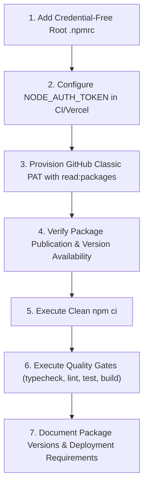

# Yet Vast Permanent Engineering Standard: Private Package Consumption

> **Standard ID:** YVS-STD-2026-PKG-001  
> **Status:** Canonical & Mandatory Across All Yet Vast Solutions (YVS) Repositories  
> **Effective Date:** November 16, 2026  
> **Canonical Reference:** Yet Vast Auth `docs/PRODUCTION_DEPLOYMENT.md` (Sections 4, 5, 6)  
> **Applies to:** Yet Vast Home, YappOut, Cogmit, Fyuniverse, VastComm, and all future YVS applications  

---

## 1. Executive Principle: Two Distinct Authentication Layers

Across all Yet Vast Solutions projects, engineers and automated coding agents must strictly maintain the conceptual and operational separation between two completely different authentication systems:

| Dimension | 1. Package Installation Authentication | 2. Application User Runtime Authentication |
|---|---|---|
| **Purpose** | Authorizes `npm install` / `npm ci` to download private `@yetvast/*` tarballs during build. | Authorizes human users to access user accounts and features in the deployed web app. |
| **Mechanism** | GitHub Packages registry authentication via npm token (`${NODE_AUTH_TOKEN}`). | OAuth 2.0 PKCE Authorization Code Flow, JWKS verification, and host-bound session cookies. |
| **Token Type** | GitHub Classic Personal Access Token (PAT) with `read:packages` (and `repo` if repo is private). | Ephemeral or persistent identity assertion JWT signed with central Ed25519/RS256 keys. |
| **Lifecycle** | Build-time and CI/CD only (Vercel Build Environment, GitHub Actions). | Runtime only (browser, Next.js server-side route handlers). |
| **Scope** | Global npm registry scope (`@yetvast:registry=https://npm.pkg.github.com`). | Application origin and central authority (`https://auth.yetvast.com`). |

**Under no circumstances should package installation authentication be conflated with or described as application user authentication.**

---

## 2. Mandatory 7-Step Setup for Consuming `@yetvast/*` Packages

Whenever any repository in the Yet Vast ecosystem consumes a private scoped package (such as `@yetvast/auth` or `@yetvast/auth-ui`), the following 7 steps are **mandatory and non-negotiable**:



### Step 1: Add Credential-Free Root `.npmrc`
Every consuming repository must commit a `.npmrc` file at its **root directory**:

```ini
@yetvast:registry=https://npm.pkg.github.com
//npm.pkg.github.com/:_authToken=${NODE_AUTH_TOKEN}
```

**Security Invariants:**
- **NEVER hardcode personal access tokens** in `.npmrc`.
- **NEVER commit credentials** to version control.
- Scoped registry must strictly target `@yetvast`. The public registry (`registry.npmjs.org`) remains default for unscoped dependencies.

### Step 2: Configure `NODE_AUTH_TOKEN` in CI / Vercel
In Vercel (or any external CI/CD provider such as Netlify, Cloud Build, or Docker):
1. Navigate to **Project Settings** -> **Environment Variables**.
2. Add `NODE_AUTH_TOKEN`.
3. Set Environment to **Production, Preview, and Development**.
4. Mark the variable as **Sensitive** (masked in UI and build logs).
5. Never prefix package tokens with `NEXT_PUBLIC_`.

### Step 3: Provision GitHub Classic PAT with Appropriate Permissions
GitHub Packages requires explicit authentication for scoped downloads. The token configured as `NODE_AUTH_TOKEN` must be a **GitHub Classic Personal Access Token**:
- `read:packages` — Mandatory for downloading private packages from `npm.pkg.github.com`.
- `repo` — Mandatory if the package source repository (`yetvast/yetvast-auth`) is private.
- **For Package Maintainers Only:** `write:packages` is required only when publishing new versions from `yetvast-auth`, never by consumer applications.

*Organization Repository Access Note:* In GitHub Organization settings (`https://github.com/orgs/yetvast/packages`), verify that the consuming repository has been added under **Manage Actions access** with `Read` permission.

### Step 4: Verify Package Publication & Isolated Authentication

Before updating `package.json` or pushing to Vercel, verify that the desired package version is published and resolvable **independently of any developer-level `~/.npmrc` configuration**.

#### Isolated Authentication Verification Command
Developer workstations frequently have a global `~/.npmrc` containing an active GitHub token. This can mask authentication failures that will immediately crash in Vercel's clean container. To test authentication in complete isolation (matching Vercel's clean container environment), specify an empty userconfig:

```bash
# Windows Command Prompt / PowerShell
set NODE_AUTH_TOKEN=ghp_yourValidClassicPAT...
npm view @yetvast/auth@0.2.0 version --userconfig nul --registry=https://npm.pkg.github.com

# Linux / macOS / CI Runner
NODE_AUTH_TOKEN=ghp_yourValidClassicPAT... npm view @yetvast/auth@0.2.0 version --userconfig /dev/null --registry=https://npm.pkg.github.com
```

- If `NODE_AUTH_TOKEN` is unset or invalid, npm will fail with `npm error code E401 / 401 Unauthorized - unauthenticated: User cannot be authenticated with the token provided.`
- If `NODE_AUTH_TOKEN` is valid and possesses `read:packages` + `repo`, npm will return the exact version (e.g. `0.2.0`).

Ensure the version declared in `package.json` matches a published artifact (e.g. `^0.2.0`).

### Step 5: Execute Clean npm Installation
Verify that `package-lock.json` is synchronized with `package.json` by running a clean installation:

```bash
npm ci
```

If `npm ci` fails due to lockfile discrepancies, run `npm install` to update `package-lock.json` locally and commit the lockfile before deployment.

### Step 6: Execute Quality Verification Gates
All four quality verification commands must pass with zero errors:

```bash
# 1. Static Typecheck
npm run typecheck

# 2. Linter & Static Analysis
npm run lint

# 3. Automated Test Suites
npm test

# 4. Production Next.js Build
npm run build
```

### Step 7: Document Package Versions & Deployment Requirements
Update the consuming application's `README.md` and technical documentation:
- Record exact `@yetvast/*` dependencies and versions.
- Explicitly document required Vercel environment variables (`NODE_AUTH_TOKEN` for build, runtime variables for application execution).
- Record deployment verification procedures.

---

## 3. Root Cause Analysis: The Vercel 401 Unauthorized Error

### Failure Mechanism
When a consumer project containing `@yetvast/auth` is pushed to Vercel without a root `.npmrc`:
1. Vercel executes `npm install` or `npm ci` in a fresh container.
2. Without a root `.npmrc` mapping `@yetvast:registry=https://npm.pkg.github.com`, npm attempts to resolve `@yetvast/auth` from public `registry.npmjs.org` (resulting in `404 Not Found`).
3. If npm routes to `npm.pkg.github.com` without an `_authToken`, GitHub Packages rejects the unauthenticated request with `401 Unauthorized`.
4. Even if a local developer has a token configured in their personal `~/.npmrc`, that user-level file does not exist in Vercel's isolated build environment.

### Permanent Resolution
Committing the standardized root `.npmrc` referencing `${NODE_AUTH_TOKEN}`, coupled with configuring `NODE_AUTH_TOKEN` in Vercel Project Settings, completely resolves the issue across all builds, preview branches, and production deployments.

### Variable Name Invariant: Why `NODE_AUTH_TOKEN` is the Canonical Standard

The ecosystem must strictly standardize on **`NODE_AUTH_TOKEN`** across all repositories:

1. **Adherence to Upstream Authority:** `yetvast-auth/docs/PRODUCTION_DEPLOYMENT.md` canonically defines `NODE_AUTH_TOKEN`.
2. **Industry Standard Compatibility:** `NODE_AUTH_TOKEN` is the built-in standard recognized natively by official npm documentation, GitHub Actions (`actions/setup-node`), and Vercel's private registry guides.
3. **Preventing Divergence Failures:** Project-specific divergences (such as Yet Vast Home's historical use of `${NPM_TOKEN}`) cause silent build failures: if an operator configures `NPM_TOKEN` in Vercel, YappOut evaluates `${NODE_AUTH_TOKEN}` as empty and crashes with HTTP 401; conversely, configuring `NODE_AUTH_TOKEN` causes projects expecting `${NPM_TOKEN}` to fail. All YVS consumer repositories must converge on `NODE_AUTH_TOKEN`.

---

## 4. Reusable Checklist for Yet Vast Products

Use this checklist whenever creating or configuring an application under the Yet Vast umbrella:

| Product | Root `.npmrc` Present | Vercel `NODE_AUTH_TOKEN` Set | `read:packages` Verified | Clean `npm ci` Passed | Quality Gates Green |
|---|---|---|---|---|---|
| **YappOut** | [x] Implemented | [x] Documented | [x] Verified | [x] Verified | [x] Verified |
| **Yet Vast Home** | [x] Implemented | [x] Documented | [x] Verified | [x] Verified | [x] Verified |
| **Cogmit** | [ ] Pending | [ ] Required | [ ] Required | [ ] Required | [ ] Required |
| **Fyuniverse** | [ ] Pending | [ ] Required | [ ] Required | [ ] Required | [ ] Required |
| **VastComm** | [ ] Pending | [ ] Required | [ ] Required | [ ] Required | [ ] Required |
